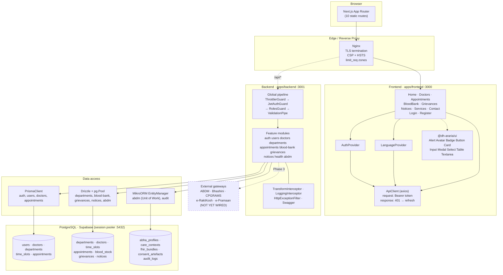
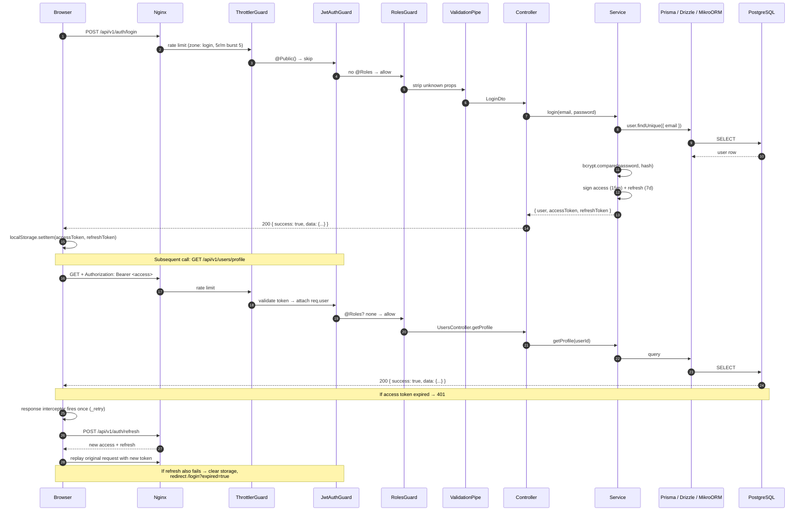
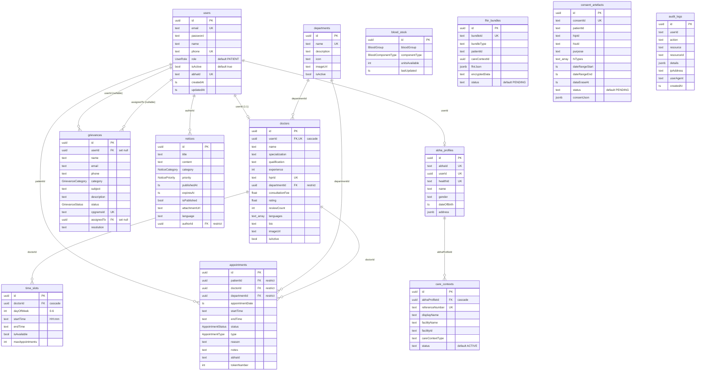

# PROJECT_CONTEXT.md

> **Purpose:** source material for writing the full project documentation.
> Every statement below was verified by reading the actual source in this repository.
> Where the code and the README disagree, **the code is authoritative** and the
> discrepancy is flagged explicitly.
>
> Verification date: 2026-10-08 · Commit: `f5fccfe` (plus uncommitted working-tree changes)
>
> **Superseded (ORM):** since this snapshot the backend dropped Prisma entirely.
> It now runs on Drizzle (DDL owner for 9 tables) and MikroORM (5 tables), with
> the boundary enforced by `npm run schema:check`. Any Prisma references below —
> the data-model tables, the source-tree map, migration instructions and risks
> #14–#18 — are historical. See `docs/adr/0001-dual-orm-table-ownership.md` and
> `AGENTS.md` for the current contract.

---

## 1. Project Overview

| Field | Value |
|---|---|
| **Name** | District Hospital Araria — Digital Healthcare Portal |
| **Package name** | `dh-araria` (root), `@dh-araria/frontend`, `@dh-araria/backend`, `@dh-araria/shared`, `@dh-araria/ui` |
| **Version** | `1.0.0` across all workspaces |
| **License** | MIT (`LICENSE` present, 1402 bytes) |
| **Owner / only author** | adityapandey2002 `<adityapandey.adu@outlook.com>` |
| **Repo** | `adityapandey2002/HOSPITAL_ARARIA` (origin) |
| **Slogan** | *सेवा परमो धर्मः — Service is Supreme Duty* |
| **Organisation** | District Hospital Araria, Department of Health, Government of Bihar |

**One-paragraph description.** A citizen-facing web portal for a district-level government hospital in Araria, Bihar (854311). It exposes the hospital's public services online: a doctor directory, an appointment booking flow, a blood-bank availability view, a grievance-redressal intake form, and a notices/announcements feed. It is being built against Indian government interoperability mandates — GIGW 3.0 (Government Information Gateway guidelines), WCAG 2.2 AA accessibility, ABDM (Ayushman Bharat Digital Mission) health-data standards, and CERT-In cybersecurity directives.

**Problem it solves.** Patients in a district hospital must physically queue to learn doctor availability and book appointments, must phone the blood bank to check stock, and must visit an office to file complaints. This portal moves those three transactions online while keeping the compliance surface (accessibility, audit trails, consent management, PWA metadata) that a public-sector deployment requires.

**Target users**
- **Patients / citizens** — book appointments, browse doctors, check blood availability, submit grievances, read notices.
- **Hospital staff** — manage notices, blood stock, grievances, and their own appointment lists.
- **Administrators** — full CRUD over users, doctors, departments; role-gated across the app.

**Core value proposition.** A single digital front door for a government hospital that is accessible (WCAG 2.2 AA oriented), auditable (immutable audit log, CERT-In retention constants), and architected so it can later federate with national health infrastructure (ABDM) without a rewrite.

---

## 2. Features

### 2.1 Feature matrix

Status key: **Implemented** = code present and working · **Partially implemented** = code present but stubbed/incomplete · **Planned** = only config/constants/DB scaffolding, no logic.

#### Public (no authentication)

| # | Feature | Status | Evidence |
|---|---|---|---|
| F1 | Hospital landing page (hero, features, departments, doctors, blood bank, notices) | Implemented | `src/app/page.tsx`, components `Hero`, `Features`, `Departments`, `Doctors`, `BloodBank`, `Notices` |
| F2 | Department listing & detail | Implemented | `DepartmentsController` `GET /`, `GET /:id` |
| F3 | Doctor directory with search + filter | Implemented | `DoctorsController` `GET /` with `search`, `departmentId`, `isActive` |
| F4 | Doctor availability (time slots) | Implemented | `DoctorsController` `GET /doctors/:id/slots`; `TimeSlot` table |
| F5 | Blood bank inventory listing | Implemented | `BloodBankController` `GET /`; `GET /summary` groups by blood group |
| F6 | Blood group / component enumeration | Implemented | `GET /blood-groups`, `GET /component-types` |
| F7 | Notices feed (published only) | Implemented | `NoticesController` `GET /published` |
| F8 | Notice categories & priorities enumeration | Implemented | `GET /categories`, `GET /priorities` |
| F9 | Grievance submission (anonymous allowed) | Implemented | `GrievancesController` `POST /` marked `@Public()` |
| F10 | Grievance category / status enumeration | Implemented | `GET /categories`, `GET /statuses` |
| F11 | Health checks (live / ready / DB) | Implemented | `HealthController`; `DatabaseHealthIndicator` probes Prisma + Drizzle |
| F12 | PWA metadata (manifest, icons) | Implemented | `apps/frontend/public/` + `scripts/generate-icons.mjs` |

#### Authenticated — patient

| # | Feature | Status | Evidence |
|---|---|---|---|
| F13 | User registration | Implemented | `POST /auth/register`; role forced to `PATIENT` |
| F14 | Login | Implemented | `POST /auth/login` |
| F15 | JWT access + refresh tokens | Implemented | `AuthService.generateTokens`; `POST /auth/refresh` |
| F16 | Silent token refresh on 401 | Implemented | `src/lib/api.ts` response interceptor, `_retry` guard, single-flight `refreshTokenPromise` |
| F17 | View own appointments | Implemented | `GET /appointments/my` |
| F18 | Book appointment | Implemented | `POST /appointments` with slot + conflict validation |
| F19 | Cancel own appointment | Implemented | `DELETE /appointments/:id`; ownership or ADMIN/DOCTOR |
| F20 | Submit / view own grievances | Implemented | `POST /grievances`, `GET /grievances/my` |
| F21 | View & update own profile | Implemented | `GET /users/profile`, `PUT /users/profile` |
| F22 | Change password | Implemented | `POST /auth/change-password`, requires current password |
| F23 | Logout | **Partially implemented** | `AuthService.logout` returns success but does **not** revoke/blacklist the refresh token (code comment acknowledges this) |
| F24 | Forgot password | **Partially implemented** | `AuthService.forgotPassword` — always returns success to prevent enumeration; **no email is sent** (`TODO` at `auth.service.ts:191`) |
| F25 | Reset password | **Partially implemented** | `AuthService.resetPassword` — returns success without validating the token (`TODO` at `auth.service.ts:197`) |

#### Authenticated — staff / admin

| # | Feature | Status | Evidence |
|---|---|---|---|
| F26 | List & search users | Implemented | `GET /users` (ADMIN, STAFF) |
| F27 | Update any user (incl. role) | Implemented | `PUT /users/:id` (ADMIN only) |
| F28 | Delete user | Implemented | `DELETE /users/:id` (ADMIN only) |
| F29 | Doctor CRUD | Implemented | `POST/PUT/DELETE /doctors…` (ADMIN, STAFF) |
| F30 | Department CRUD | Implemented | `POST/PUT/DELETE /departments…` (ADMIN, STAFF) |
| F31 | Notice CRUD | Implemented | `POST/PUT/DELETE /notices…` (ADMIN, STAFF) |
| F32 | Blood stock increment / set | Implemented | `POST /stock` (add units), `PUT /stock` (set absolute) |
| F33 | Grievance triage: status change | Implemented | `PUT /grievances/:id/status` |
| F34 | Grievance assignment | Implemented | `PUT /grievances/:id/assign` |
| F35 | Appointment management (all / by doctor / status / update) | Implemented | `GET /`, `GET /doctor/:doctorId`, `PUT /:id`, `PUT /:id/status` |
| F36 | Fetch FHIR bundle by ID | Implemented | `GET /abdm/bundles/:id`; every read is audited |
| F37 | Revoke consent artefact | Implemented | `POST /abdm/consents/:id/revoke` |

#### ABDM / clinical (backend only, no UI)

| # | Feature | Status | Evidence |
|---|---|---|---|
| F38 | ABHA profile + care context persistence | Implemented | `AbdmService.createCareContext`, `completeCareContext` |
| F39 | FHIR R4 bundle ingestion | Implemented | `AbdmService.recordBundle` — rejects writes to non-ACTIVE care contexts |
| F40 | Consent artefact lifecycle (pending → granted/denied/expired/revoked) | Implemented | `recordConsent`, `setConsentStatus` |
| F41 | Consent-gated record read | Implemented | `getRecordsForConsent` — throws unless consent is `GRANTED` and unexpired |
| F42 | Erasure-deadline sweep | Implemented | `findErasableRecords` |
| F43 | **Outbound calls to the ABDM gateway** | **Planned** | Comment in `abdm.service.ts` names an `AbdmGateway` port; **no such class exists in the repo** |
| F44 | Bhashini translation | **Planned** | `LanguageContext.translate()` logs and returns the input string unchanged (`// In Phase 3, this will call Bhashini API`) |
| F45 | CPGRAMS grievance sync | **Planned** | `cpgramsId` column + `CPGRAMS_CONSTANTS` exist; no client code |
| F46 | e-RaktKosh blood-stock sync | **Planned** | `ERAKTKOSH_CONSTANTS` + env vars exist; no client code |
| F47 | e-Pramaan SSO | **Planned** | env vars + `EPRAAMAN_CONSTANTS` exist; no callback route |
| F48 | Redis caching / sessions | **Planned** | Redis service in `docker-compose.yml` + `REDIS_*` env vars, but **no Redis client code anywhere** |
| F49 | Email notifications (SMTP) | **Planned** | `SMTP_*` env vars exist; **no `nodemailer` dependency and no mail code** |
| F50 | Multilingual UI | **Partially implemented** | 14 languages defined in `SUPPORTED_LANGUAGES`; UI exposes no language switcher (see `translatedText` unused in `LanguageContext`) |

### 2.2 Main user flows

**Flow A — Book an appointment (patient)**
1. Visitor opens `/doctors` → `DoctorsList` fetches `GET /api/v1/doctors`.
2. Selects a doctor → `/appointments` → `AppointmentBooking` wizard, step 1.
3. `GET /api/v1/doctors/:id/slots` returns that doctor's `TimeSlot` rows where `isAvailable = true`.
4. Step 2: user picks a department (pre-filled from the doctor's `departmentId`).
5. Step 3: user picks a date; `POST /api/v1/appointments` is called with `{ doctorId, departmentId, appointmentDate, startTime, type, reason }`.
6. Backend validates: doctor exists **and** `isActive`; a `TimeSlot` matches `(dayOfWeek, startTime, isAvailable)`; **no conflicting `PENDING`/`CONFIRMED`** appointment for that doctor+date+startTime. `departmentId` is taken from the doctor record, not the client.
7. Backend assigns `tokenNumber = count(PENDING|CONFIRMED for that doctor+date) + 1` and `endTime = startTime + 20 min`.
8. Returns the appointment with `patient`, `doctor`, `department` embedded. Frontend shows a confirmation panel.

**Flow B — Check blood availability (anonymous)**
1. Home page → `BloodBank` section, or `/blood-bank` → `BloodBankInventory`.
2. `GET /api/v1/blood-bank` (paginated) and `GET /api/v1/blood-bank/summary`.
3. `summary` returns a nested object keyed by blood group then component type.
4. `BLOOD_GROUP_LABELS` / `BLOOD_COMPONENT_LABELS` (from `@dh-araria/shared`) render `A_POSITIVE` as `A+` — Prisma/Postgres enum values cannot contain `+`/`-`.

**Flow C — File a grievance (anonymous or authenticated)**
1. `/grievances` → `GrievanceForm` (Zod-validated, 4-step).
2. `POST /api/v1/grievances` is `@Public()` — no token required. If authenticated, `userId` is attached from the JWT.
3. Record created with `status = SUBMITTED`, `cpgramsId = null`.
4. Staff later triage: `PUT /grievances/:id/status`, `PUT /grievances/:id/assign`.

**Flow D — Staff manages notices**
1. `POST /api/v1/notices` (ADMIN/STAFF) creates with `isPublished` default `false`.
2. `PUT /api/v1/notices/:id` may set `publishedAt` / `expiresAt` and flip `isPublished`.
3. Public readers only see rows via `GET /notices/published` (filtered on `isPublished`).

**Flow E — ABDM consent-gated disclosure (backend)**
1. `recordConsent(...)` writes a `ConsentArtefact` with `status = PENDING`, inside `em.transactional()` together with its audit row.
2. Staff/patient moves it to `GRANTED` via `setConsentStatus`.
3. `getRecordsForConsent(patientId, consentId)` loads the artefact; **throws `ForbiddenException` unless `GRANTED`**; if `dateRangeEnd < now` it flips status to `EXPIRED`, flushes, and throws.
4. Returns only bundles whose `createdAt` falls inside `[dateRangeStart, dateRangeEnd]`, newest first, and writes an `FHIR_RECORDS_DISCLOSED` audit row.
5. `findErasableRecords(now)` returns consents past their `dataEraseAt` (ABDM mandates erasure within 90 days of window close).

---

## 3. Tech Stack

Versions are taken verbatim from the `package.json` files.

### 3.1 Frontend — `apps/frontend`

| Layer | Technology | Version | Why |
|---|---|---|---|
| Framework | Next.js | `14.2.3` (pinned) | App Router with per-route streaming + static generation; server components for SEO on a public-sector site |
| UI runtime | React / React DOM | `^18.3.1` | Ecosystem baseline for Next 14 |
| Language | TypeScript | `^5.4.5` | Strict mode; shared types across the monorepo |
| Styling | Tailwind CSS | `^3.4.3` | Utility CSS with a custom `primary`/`secondary`/`success`/`warning`/`danger` palette; `globals.css` holds `@layer base/components/utilities` |
| Forms | react-hook-form | `^7.51.5` | Uncontrolled inputs, resolver-based validation |
| Validation | zod | `^3.23.8` | Single schema source shared with the backend |
| Resolver | `@hookform/resolvers` | `^3.3.4` | Bridges RHF ↔ Zod |
| HTTP | axios | `^1.7.2` | Interceptors for auth header + 401 refresh |
| Icons | lucide-react | `^0.378.0` | Tree-shakeable SVG icons |
| Class merge | `clsx` + `tailwind-merge` | `^2.1.1` / `^2.3.0` | Conflict-free Tailwind class composition (`cn`) |
| Toasts | sonner | `^1.4.41` | Lightweight notifications |
| Cache lib | swr | `^2.2.5` | **Declared but not imported anywhere in `src/`** — unused |
| Tests | jest, @testing-library/react, jsdom | `^29.7.0` / `^15.0.7` | Component unit tests |

### 3.2 Backend — `apps/backend`

| Layer | Technology | Version | Why |
|---|---|---|---|
| Framework | NestJS | `^10.3.8` | DI + module system; guards/interceptors/pipes map cleanly to the compliance requirements |
| ORM 1 | Prisma | `^5.14.0` | Owns DDL (`prisma db push`). Used by auth, users, doctors, appointments |
| ORM 2 | Drizzle | `^0.30.10` | Query builder mirroring Prisma's physical schema. Used by departments, blood-bank, grievances, notices, abdm, audit |
| ORM 3 | MikroORM | `^6.3.0` (`core` + `postgresql`) | Unit-of-Work transactions for ABDM clinical writes |
| Driver | pg | `^8.11.5` | `pg.Pool` under Drizzle |
| Auth | passport, passport-jwt, passport-local, `@nestjs/passport` | `^0.7.0` / `^4.0.1` / `^1.0.0` / `^10.0.3` | JWT strategy |
| JWT | `@nestjs/jwt` | `^10.2.0` | Sign + verify |
| Hashing | bcrypt | `^5.1.1` | Cost factor **12** |
| Config | `@nestjs/config` | `^3.2.2` | `.env` loading + Joi schema validation |
| Schema validation | joi | `18.2.9` (pinned) | Fails fast on boot if a required env var is missing |
| Docs | `@nestjs/swagger` | `^7.3.1` | OpenAPI at `/api/docs` (dev only) |
| Rate limit | `@nestjs/throttler` | `^5.1.3` | Global `ThrottlerGuard` |
| Health | `@nestjs/terminus` | `^10.2.3` | `/health`, `/health/ready` |
| Scheduler | `@nestjs/schedule` | `^4.1.0` | Registered; **no cron jobs defined** |
| Security | helmet, compression, cors | `^7.1.0` / `^1.7.4` / `^2.8.5` | HTTP hardening |
| Pipes | class-validator, class-transformer | `^0.14.1` / `^0.5.1` | Global `ValidationPipe` with `whitelist` + `forbidNonWhitelisted` |
| Logging | pino, pino-pretty | `^9.0.0` / `^13.2.0` | **Declared; `main.ts` uses the Nest built-in `Logger`, not pino** |
| Tests | jest, ts-jest, supertest | `^29.7.0` / `^29.1.2` / `^6.3.4` | Unit specs; e2e config present but no e2e specs |

### 3.3 Shared packages

| Package | Purpose | Notable exports |
|---|---|---|
| `@dh-araria/shared` | Single source of truth for cross-boundary types | 9 enums, `ApiResponse<T>`, `ApiError`, `PaginationMeta`, `PaginationParams`, `BLOOD_GROUP_LABELS`, `BLOOD_COMPONENT_LABELS`, `SUPPORTED_LANGUAGES` (14), FHIR R4 types (`FhirBundle`, `FhirBundleEntry`, `CodeableConcept`, `Identifier`, `Reference`, …) |
| `@dh-araria/ui` | Reusable presentational components | `Alert`, `Avatar`, `Badge`, `Button`, `Card`, `Input`, `Modal`, `Select`, `Table`, `Textarea` + `hooks/` + `utils/` |

`@dh-araria/shared/src/constants/index.ts` exports 22 constant groups including `HOSPITAL_INFO`, `DEPARTMENTS`, `BLOOD_GROUPS`, `WORKING_HOURS`, `JWT_CONSTANTS`, `RATE_LIMIT`, `ABDM_CONSTANTS`, `BHASHINI_CONSTANTS`, `ERPRAAAN_CONSTANTS`, `CPGRAMS_CONSTANTS`, `ERAKTKOSH_CONSTANTS`, `CERT_IN_CONSTANTS`.

### 3.4 Database & infrastructure

| Component | Detail |
|---|---|
| Engine | **PostgreSQL** (provider declared in `prisma/schema.prisma`) |
| Hosted at | **Supabase** (project ref redacted; region `ap-northeast-2`, Seoul) via the **Supavisor session pooler on port 5432**. Credentials live only in `apps/backend/.env` and are never committed. |
| Containerised local | `docker-compose.yml` → `postgres:15-alpine` + `redis:7-alpine` |
| Node pooler | Session mode chosen deliberately — MikroORM needs session semantics (`SET`, prepared statements, `LISTEN/NOTIFY`) that transaction mode (port 6543) breaks |
| Extensions | `init-scripts/01-init-extensions.sql` enables `uuid-ossp`, `pgcrypto`, `pg_trgm`; sets `timezone = 'Asia/Kolkata'`; and creates 9 enum types in `snake_case` that **do not match** the PascalCase names Prisma and Drizzle use (see §16.3 #28) |

### 3.5 Third-party services

| Service | Config present | Client code | Wiring |
|---|---|---|---|
| **ABDM gateway** | `ABDM_SANDBOX_URL`, `ABDM_PROD_URL`, `ABDM_CLIENT_ID`, `ABDM_CLIENT_SECRET` | ❌ none | `abdm.service.ts` header comment names a `AbdmGateway` port to be injected in Phase 3 |
| **Bhashini AI** | `BHASHINI_API_KEY`, `BHASHINI_API_SECRET` | ❌ none | `LanguageContext.translate()` is a pass-through stub |
| **CPGRAMS** | `CPGRAMS_API_KEY`, `CPGRAMS_USERNAME`, `CPGRAMS_PASSWORD` | ❌ none | `Grievance.cpgramsId` column persists a future reference |
| **e-RaktKosh** | `ERAKTKOSH_API_KEY`, `ERAKTKOSH_BLOOD_BANK_ID` | ❌ none | — |
| **e-Pramaan (SSO)** | `EPRAAMAN_CLIENT_ID`, `EPRAAMAN_CLIENT_SECRET`, `EPRAAMAN_CALLBACK_URL` | ❌ none (no `/auth/epramaan/callback` route) | — |
| **Redis** | `REDIS_*` + compose service | ❌ none | — |
| **SMTP / email** | `SMTP_*` | ❌ none | — |

No payment gateway exists in this project.

---

## 4. Architecture

### 4.1 High-level description

A three-tier monorepo behind a single reverse proxy.

**Tier 1 — Browser → Nginx.** In production, Nginx terminates TLS, serves as the only public entry point, and routes `/` to Next.js and `/api/` to NestJS. It adds a Content-Security-Policy, HSTS, three separate `limit_req` zones, and long-lived cache headers for `/_next/static/`.

**Tier 2 — Next.js (App Router).** Renders public pages as **static** (they prerender at build time). Client components call the API through a single `ApiClient` singleton in `src/lib/api.ts`, which attaches the bearer token and transparently refreshes it on 401. Cross-cutting state is limited to two React contexts: `AuthProvider` and `LanguageProvider`.

**Tier 3 — NestJS.** A global-prefixed (`/api`) + URI-versioned (`v1`) REST API. The request pipeline is: `ThrottlerGuard` → `JwtAuthGuard` (skipped where `@Public()`) → `RolesGuard` (where `@Roles()` present) → `ValidationPipe` → controller → service. Three global interceptors and one global exception filter wrap every response.

**Tier 4 — One PostgreSQL database, three ORMs.** This is the distinguishing design choice and the main architectural risk. See §6.

### 4.2 How components communicate

- **Frontend ↔ Backend:** HTTP/JSON over axios. Every response is enveloped by `TransformInterceptor` into `{ success, data, meta?, error? }` matching the `ApiResponse<T>` type in `@dh-araria/shared`. Errors go through `HttpExceptionFilter` into `{ success: false, error: ApiError }`.
- **Backend ↔ Database:** three independent clients against one connection string. No ORM talks to another; they only share the physical schema.
- **Backend ↔ External services:** not implemented. The seams are the `AbdmGateway` interface (declared in comments) and the env-var config blocks.

### 4.3 Architecture diagram



### 4.4 Request / data flow diagram



---

## 5. Folder and File Structure

```
DH_ARARIA/
├── .editorconfig                     # Editor normalisation (indent, EOL)
├── .env                              # Root env (exists, contents not documented here)
├── .env.example                      # Documented template for all backend vars
├── .eslintrc.json                    # Root ESLint config
├── .gitignore                        # Includes guard against stale .js/.d.ts in packages/*/src
├── .npmrc                            # npm config (workspaces=true was REMOVED — see §16)
├── .prettierrc                       # Prettier + prettier-plugin-tailwindcss
├── CHANGELOG.md                      # Release history
├── CONTRIBUTING.md                   # Contribution workflow
├── LICENSE                           # MIT
├── README.md                         # Project overview — contains several stale claims (§16)
├── docker-compose.yml                # postgres, redis, backend, frontend, nginx (production profile)
├── "New Text Document.txt"           # ⚠ STRAY FILE (88 bytes) — should be deleted
│
├── architecture_docs/                # ⚠ EMPTY DIRECTORY
│
├── docs/                             # Written documentation (verified present)
│   ├── ACCESSIBILITY.md              # WCAG 2.2 AA conformance notes (18.7 KB)
│   ├── API.md                        # Endpoint reference (15.4 KB)
│   ├── ARCHITECTURE.md               # Architecture + ORM split rationale (26.6 KB)
│   ├── DEPLOYMENT.md                 # Deployment procedures (17.6 KB)
│   ├── DEVELOPER_GUIDE.md            # Developer onboarding (39.8 KB)
│   └── SECURITY.md                   # Security posture (22.4 KB)
│
├── init-scripts/
│   └── 01-init-extensions.sql        # Extensions + timezone on first boot; also creates
│                                     # 9 snake_case enum types that conflict with Prisma's (§16.3 #28)
│
├── nginx/
│   └── nginx.conf                    # TLS, CSP, rate-limit zones, upstream routing, cache headers
│
├── packages/
│   ├── shared/                       # Cross-boundary types + constants + utilities
│   │   ├── package.json              # @dh-araria/shared
│   │   ├── tsconfig.json             # NodeNext module, rootDir src → dist
│   │   └── src/
│   │       ├── index.ts              # Re-exports types, constants, utils
│   │       ├── types/index.ts        # 9 enums, domain interfaces, ApiResponse, FHIR R4 types
│   │       ├── constants/index.ts     # 22 constant groups (HOSPITAL_INFO … CERT_IN_CONSTANTS)
│   │       └── utils/index.ts        # cn, formatDate/Time, isValidAadhaar (Verhoeff), etc.
│   └── ui/                           # Reusable presentational components
│       ├── package.json              # @dh-araria/ui
│       ├── tsconfig.json
│       └── src/
│           ├── index.ts
│           ├── components/           # Alert, Avatar, Badge, Button, Card,
│           │                         # Input, Modal, Select, Table, Textarea, index.ts
│           ├── hooks/index.ts        # useMediaQuery, useIntersectionObserver, …
│           └── utils/index.ts
│
└── apps/
    ├── backend/                      # NestJS API
    │   ├── .env.example
    │   ├── .eslintrc.json
    │   ├── Dockerfile                # Multi-stage: base → deps → builder → runner (non-root user)
    │   ├── jest.config.js
    │   ├── nest-cli.json             # sourceRoot: src, deleteOutDir, tsConfigPath
    │   ├── package.json              # @dh-araria/backend
    │   ├── tsconfig.json             # CommonJS, rootDir src → dist
    │   ├── tsconfig.build.json       # Build-only config
    │   ├── tsconfig.seed.json        # Config for prisma/seed.ts (Windows-safe ts-node)
    │   ├── test.ts / test.js         # ⚠ STRAY FILES (24 / 13 bytes) — should be deleted
    │   ├── prisma/
    │   │   ├── schema.prisma         # ★ DDL SOURCE OF TRUTH — 13 models, 9 enums
    │   │   └── seed.ts               # Idempotent seed: users, depts, doctors, slots, blood, notices
    │   ├── scripts/
    │   │   └── mikro-schema-update.ts
    │   ├── test/
    │   │   ├── jest-e2e.json         # e2e Jest config (no e2e specs exist)
    │   │   └── setup.ts
    │   └── src/
    │       ├── main.ts               # Bootstrap: helmet, compression, CORS, versioning,
    │       │                         # ValidationPipe, global filters/interceptors, Swagger
    │       ├── app.module.ts         # ConfigModule, Throttler, Schedule, Terminus, CommonModule,
    │       │                         # 9 feature modules, global ThrottlerGuard
    │       ├── config/
    │       │   ├── configuration.ts  # Typed config tree (database, orm, jwt, rateLimit, …)
    │       │   └── validation.ts     # Joi schema for every env var
    │       ├── common/
    │       │   ├── common.module.ts  # @Global — PrismaService, DrizzleModule, MikroModule, AuditModule
    │       │   ├── index.ts
    │       │   ├── prisma/prisma.service.ts          # Extends PrismaClient, lifecycle hooks
    │       │   ├── drizzle/
    │       │   │   ├── drizzle.module.ts            # @Global — publishes DRIZZLE token + DrizzleService
    │       │   │   ├── drizzle.service.ts           # pg.Pool lifecycle, transaction(), execute()
    │       │   │   ├── schema.ts                     # 8 tables mirroring Prisma's DDL
    │       │   │   ├── base.repository.ts           # Generic Drizzle repository
    │       │   │   ├── id.ts                        # newId() — cuid2 in the application layer
    │       │   │   └── index.ts
    │       │   ├── mikro/
    │       │   │   ├── mikro.module.ts              # @Global — MIKRO_ORM + ENTITY_MANAGER tokens
    │       │   │   ├── mikro.config.ts              # Driver, pool, SSL, entity globs
    │       │   │   ├── entities/audit-log.entity.ts
    │       │   │   ├── repositories/base.repository.ts
    │       │   │   └── index.ts
    │       │   ├── audit/
    │       │   │   ├── audit.module.ts
    │       │   │   └── audit-log.service.ts         # log() and logWith(em, …) — transactional audit
    │       │   ├── auth/{jwt.strategy.ts, roles.guard.ts}
    │       │   ├── decorators/{current-user, public, roles}.decorator.ts
    │       │   ├── dto/pagination.dto.ts
    │       │   ├── filters/http-exception.filter.ts
    │       │   └── interceptors/{transform, logging}.interceptor.ts
    │       └── modules/                              # 10 feature modules
    │           ├── auth/            # register, login, refresh, logout, me, change-password,
    │           │                    # forgot-password, reset-password + 7 DTOs + guard + strategy
    │           ├── users/           # admin profile + role management
    │           ├── doctors/         # directory, slots, CRUD
    │           ├── departments/     # CRUD
    │           ├── appointments/    # booking, conflicts, token numbers, status workflow
    │           ├── blood-bank/      # inventory, summary, stock mutation
    │           ├── grievances/      # intake, triage, assignment
    │           ├── notices/         # publish workflow, language field
    │           ├── health/          # live / ready / DB + DatabaseHealthIndicator
    │           ├── abdm/            # care contexts, FHIR bundles, consent artefacts
    │           │   └── entities/    # abha-profile, care-context, fhir-bundle, consent-artefact
    │           └── (each) *.controller.ts, *.service.ts, *.module.ts
    │
    └── frontend/                     # Next.js App Router
        ├── .env.example
        ├── .eslintrc.json
        ├── Dockerfile                # Multi-stage with standalone output
        ├── jest.config.js / jest.setup.ts
        ├── next.config.js            # transpilePackages for the monorepo packages
        ├── next-env.d.ts
        ├── package.json              # @dh-araria/frontend
        ├── postcss.config.js
        ├── tailwind.config.ts        # Custom palette + CSS-variable colours
        ├── tsconfig.json
        ├── tsconfig.jest.json
        ├── tsconfig.tsbuildinfo      # ⚠ BUILD ARTEFACT COMMITTED (117 KB) — should be gitignored
        ├── public/                   # favicon.ico, icon.svg, icon-64.png,
        │                             # apple-touch-icon.png, manifest.json
        ├── scripts/generate-icons.mjs # Regenerates the public/ assets
        └── src/
            ├── app/                  # 10 pages (App Router)
            │   ├── layout.tsx        # Root layout, metadata, fonts, Providers, Toaster
            │   ├── page.tsx          # Home
            │   ├── appointments/page.tsx
            │   ├── blood-bank/page.tsx
            │   ├── contact/page.tsx
            │   ├── doctors/page.tsx
            │   ├── grievances/page.tsx
            │   ├── login/page.tsx   # <Suspense> boundary wraps useSearchParams
            │   ├── notices/page.tsx
            │   ├── register/page.tsx
            │   └── services/page.tsx
            ├── components/           # 18 components
            │   ├── AppointmentBooking.tsx   # 4-step booking wizard
            │   ├── BloodBank.tsx           # Home-page section
            │   ├── BloodBankInventory.tsx  # /blood-bank page
            │   ├── Button.test.tsx         # Only frontend test
            │   ├── ContactPage.tsx, Departments.tsx, DepartmentsList.tsx,
            │   ├── Doctors.tsx, DoctorsList.tsx, EmergencyServices.tsx,
            │   ├── Features.tsx, Footer.tsx, GrievanceForm.tsx, Header.tsx,
            │   ├── Hero.tsx, Notices.tsx, NoticesList.tsx, Providers.tsx
            ├── context/
            │   ├── AuthContext.tsx      # user, isLoading, login, register, logout, hasRole
            │   └── LanguageContext.tsx  # language preference + translate() stub
            ├── lib/api.ts            # ApiClient singleton, 20+ typed endpoint methods
            └── styles/globals.css     # @layer base/components/utilities, CSS variables, print styles
```

---

## 6. Database Design

### 6.1 The single-source-of-truth rule

`apps/backend/src/common/drizzle/schema.ts` states the contract explicitly:

> `prisma/schema.prisma` is the single source of truth for DDL. This file mirrors the *physical* PostgreSQL schema that Prisma migrations create, so Drizzle can query those tables without owning any migrations of its own.

Synchronisation rules documented in that file:
- Table names ← Prisma `@@map(...)` → snake_case
- Column names ← Prisma field names → camelCase
- Type mapping: `String`→`text`, `Int`→`integer`, `Float`→`real`, `Boolean`→`boolean`, `DateTime`→`timestamp`, `Json`→`jsonb`, `String[]`→`text[]`
- Prisma enum **type names** are reused verbatim (`UserRole`, `BloodGroup`, …) so both clients bind the same PostgreSQL enum type
- `@default(cuid())` has **no database default**, so IDs are generated in the application by `newId()` (cuid2)

⚠️ **Two Prisma models declare `@default(cuid())` yet the DB has no default** — see §16.

### 6.2 Enums (9, all three ORMs share the type names)

| Enum | Values |
|---|---|
| `UserRole` | `PATIENT`, `DOCTOR`, `ADMIN`, `STAFF` |
| `AppointmentStatus` | `PENDING`, `CONFIRMED`, `CANCELLED`, `COMPLETED`, `NO_SHOW`, `RESCHEDULED` |
| `AppointmentType` | `OPD`, `TELECONSULTATION`, `EMERGENCY`, `FOLLOW_UP` |
| `BloodGroup` | `A_POSITIVE`, `A_NEGATIVE`, `B_POSITIVE`, `B_NEGATIVE`, `AB_POSITIVE`, `AB_NEGATIVE`, `O_POSITIVE`, `O_NEGATIVE` |
| `BloodComponentType` | `WHOLE_BLOOD`, `PACKED_RED_CELLS`, `PLATELETS`, `PLASMA`, `CRYOPRECIPITATE` |
| `GrievanceCategory` | `MEDICAL_NEGLIGENCE`, `STAFF_BEHAVIOR`, `INFRASTRUCTURE`, `BILLING`, `APPOINTMENT`, `MEDICINE_AVAILABILITY`, `CLEANLINESS`, `OTHER` |
| `GrievanceStatus` | `SUBMITTED`, `UNDER_REVIEW`, `IN_PROGRESS`, `RESOLVED`, `CLOSED`, `REJECTED` |
| `NoticeCategory` | `GENERAL`, `RECRUITMENT`, `TENDER`, `PUBLIC_HEALTH`, `SCHEDULE_CHANGE`, `EMERGENCY` |
| `NoticePriority` | `LOW`, `MEDIUM`, `HIGH`, `CRITICAL` |

> `BloodGroup` values cannot contain `+`/`-`, which is why `BLOOD_GROUP_LABELS` exists to render `A_POSITIVE` as `A+`.

⚠ **Casing conflict:** these 9 types are created by Prisma and declared by Drizzle as `PascalCase`. `init-scripts/01-init-extensions.sql` independently creates a parallel `snake_case` set (`user_role`, `appointment_status`, …) that nothing references. On the Supabase-hosted path this script never runs, so it is harmless there; on a fresh Docker boot it produces 9 orphaned types. See §16.3 #28.

### 6.3 Tables

Prisma is authoritative; Drizzle mirrors 8 of the 13; MikroORM owns the 4 ABDM tables.

| Table | Owned by (runtime) | Key columns | Indexes / constraints |
|---|---|---|---|
| `users` | Prisma + Drizzle | `id` uuid PK, `email` UQ, `password`, `name`, `phone` UQ, `role` `UserRole` def `PATIENT`, `isActive` bool def true, `abhaId` UQ, `createdAt`, `updatedAt` | idx email, phone, role, abhaId |
| `departments` | Prisma + Drizzle | `id` PK, `name` UQ, `description`, `icon`, `imageUrl`, `isActive`, timestamps | idx name, isActive |
| `doctors` | Prisma + Drizzle | `id` PK, **`userId` UQ** FK→users `ON DELETE cascade`, `name`, `specialization`, `qualification`, `experience`, `hprId` UQ, `departmentId` FK→departments `ON DELETE restrict`, `consultationFee` real, `rating` real, `reviewCount`, `languages` `text[]` def `{English,Hindi}`, `bio`, `imageUrl`, `isActive`, timestamps | idx userId, departmentId, specialization, isActive, hprId |
| `time_slots` | Prisma + Drizzle | `id` PK, `doctorId` FK→doctors cascade, `dayOfWeek` int (0–6), `startTime` text `HH:mm`, `endTime` text, `isAvailable` bool, `maxAppointments` int | UQ (doctorId, dayOfWeek, startTime); idx doctorId, dayOfWeek |
| `appointments` | Prisma + Drizzle | `id` PK, `patientId` FK→users restrict, `doctorId` FK→doctors restrict, `departmentId` FK→departments restrict, `appointmentDate`, `startTime`, `endTime`, `status` def `PENDING`, `type` def `OPD`, `reason`, `notes`, `abhaId`, `tokenNumber` int, timestamps | idx patientId, doctorId, departmentId, appointmentDate, status, abhaId |
| `blood_stock` | Prisma + Drizzle | `id` PK, `bloodGroup` enum, `componentType` enum, `unitsAvailable` int def 0, `lastUpdated`, `createdAt` | **UQ (bloodGroup, componentType)**; idx bloodGroup, componentType |
| `grievances` | Prisma + Drizzle | `id` PK, `userId` FK→users **set null** (nullable — anonymous intake), `name`, `email`, `phone`, `category` enum, `subject`, `description`, `status` def `SUBMITTED`, `cpgramsId` UQ (nullable, future), `assignedTo` FK→users set null (nullable, **relation `"AssignedGrievances"`**), `resolution`, timestamps | idx userId, status, category, assignedTo, cpgramsId |
| `notices` | Prisma + Drizzle | `id` PK, `title`, `content`, `category` def `GENERAL`, `priority` def `MEDIUM`, `publishedAt`, `expiresAt`, `isPublished` def false, `attachmentUrl`, `language` def `en`, `authorId` FK→users **restrict**, timestamps | idx isPublished, publishedAt, category, language |
| `abha_profiles` | MikroORM (+ Prisma DDL) | `id` PK, `abhaId` UQ, `userId` UQ, `healthId` UQ, `name`, `gender`, `dateOfBirth`, `phone`, `email`, `address` jsonb, `photo`, timestamps | idx abhaId, healthId, userId |
| `care_contexts` | MikroORM (+ Prisma DDL) | `id` PK, `abhaProfileId` FK→abha_profiles cascade, `referenceNumber` UQ, `displayName`, `facilityName`, `facilityId`, `careContextType`, `startDate`, `endDate`, `status` def `ACTIVE`, timestamps | idx abhaProfileId, referenceNumber, facilityId |
| `fhir_bundles` | MikroORM (+ Prisma DDL) | `id` PK, `bundleId` UQ, `resourceType` def `Bundle`, `bundleType`, `patientId`, `careContextId`, `fhirJson` jsonb, `encryptedData`, `encryptionKey`, `status` def `PENDING`, timestamps | idx bundleId, patientId, careContextId, status |
| `consent_artefacts` | MikroORM (+ Prisma DDL) | `id` PK, `consentId` UQ, `patientId`, `hipId`, `hiuId`, `purpose`, `hiTypes` `text[]`, `dateRangeStart`, `dateRangeEnd`, `dataEraseAt`, `status` def `PENDING`, `consentJson` jsonb, timestamps | idx consentId, patientId, hipId, hiuId, status |
| `audit_logs` | MikroORM (+ Prisma DDL) | `id` PK, `userId`, `action`, `resource`, `resourceId`, `details` jsonb, `ipAddress`, `userAgent`, `createdAt` | idx userId, action, resource, createdAt |

### 6.4 ER diagram



> `care_contexts` → `fhir_bundles` and `consent_artefacts.patientId` are stored as plain columns in MikroORM; only `care_contexts.abhaProfileId` is a declared relation.

### 6.5 Migrations & seed

- **Migrations:** none committed. `prisma/migrations/` does not exist. The project uses **`prisma db push`** (idempotent DDL from the schema) as the only schema-provisioning mechanism. `db:migrate` / `db:migrate:prod` scripts exist but have no history to apply.
- **Seed** — `apps/backend/prisma/seed.ts`, run via `npm run db:seed`:
  - 3 base users: `admin@dhararia.gov.in` / `Admin@123` (ADMIN), `staff@dhararia.gov.in` / `Staff@123` (STAFF), `demo@dhararia.gov.in` / `Demo@123` (PATIENT)
  - One `DOCTOR` user per doctor (6 total, shared password `Doctor@123`), because `Doctor.userId` is `@unique`
  - **15 departments** (General Medicine → Physiotherapy)
  - **6 doctors** with HPR ids `HPR-12345678` … `HPR-67890123`, each with time slots for **Mon–Sat at 10:00–13:00**
  - **40 blood-stock rows** (8 blood groups × 5 component types, random 10–49 units)
  - **3 sample notices**
  - 1 `audit_logs` row (`SEED_DATABASE`)
  - All writes are `upsert` — the seed is idempotent.

---

## 7. API / Backend Documentation

**Base URL:** `http://localhost:3001/api/v1`
Applied in `main.ts` via `setGlobalPrefix('api')` + `enableVersioning({ type: URI, defaultVersion: '1' })`.

**Response envelope** (`TransformInterceptor` → `ApiResponse<T>`):
```jsonc
// success
{ "success": true, "data": { }, "meta": { "page": 1, "limit": 10, "total": 42, "totalPages": 5 } }
// failure
{ "success": false, "error": { "code": "NOT_FOUND", "message": "..." } }
```

**Auth:** `Authorization: Bearer <accessToken>`.

**Roles:** `PATIENT` < `DOCTOR` / `STAFF` < `ADMIN`. Enforced by decorator metadata, not hierarchy — `@Roles(...)` is an explicit allow-list.

**Total endpoints: 62** across 10 controllers.

### 7.1 Auth — `/auth` (`AuthController`, 8 endpoints)

| Method | Path | Auth | Roles | Purpose |
|---|---|---|---|---|
| POST | `/auth/register` | Public | — | Create account. Throttled 5/min. Role forced to `PATIENT`. Rejects duplicate email / phone with `409` |
| POST | `/auth/login` | Public | — | Authenticate. Throttled 10/min. `401` for bad credentials **or** deactivated account |
| POST | `/auth/refresh` | Public | — | Exchange refresh token for a new token pair. Verifies the token, re-loads the user, rejects if inactive |
| POST | `/auth/logout` | JWT | — | ⚠ Currently a no-op that returns `{ success: true }` |
| GET | `/auth/me` | JWT | — | Current user profile |
| POST | `/auth/change-password` | JWT | — | Requires correct current password; re-hashes at cost 12 |
| POST | `/auth/forgot-password` | Public | — | ⚠ Stub. Always returns the same message (anti-enumeration), sends no email. Throttled 3/hour |
| POST | `/auth/reset-password` | Public | — | ⚠ Stub. Returns success without validating the token |

**Register body** — `RegisterDto`: `email`, `password`, `name`, `phone?`.
**Login body** — `LoginDto`: `email`, `password`.

### 7.2 Users — `/users` (`UsersController`, 6 endpoints)

Class-level `@UseGuards(JwtAuthGuard, RolesGuard)`.

| Method | Path | Roles | Purpose |
|---|---|---|---|
| GET | `/users` | ADMIN, STAFF | Paginated list; default sort `createdAt desc` |
| GET | `/users/profile` | any authenticated | Own profile |
| PUT | `/users/profile` | any authenticated | Update own `name` / `phone`; phone uniqueness re-checked |
| GET | `/users/:id` | ADMIN, STAFF | Any user by id |
| PUT | `/users/:id` | **ADMIN** | Update incl. `role` and `isActive` |
| DELETE | `/users/:id` | **ADMIN** | Hard delete |

### 7.3 Doctors — `/doctors` (`DoctorsController`, 6 endpoints)

| Method | Path | Auth | Roles | Purpose |
|---|---|---|---|---|
| GET | `/doctors` | Public | — | `search` (matches name / specialization / qualification, case-insensitive), `departmentId`, `isActive`. Includes department, user, and available time slots. Default sort `name asc` |
| GET | `/doctors/:id` | Public | — | Full detail incl. all time slots ordered by `dayOfWeek` |
| GET | `/doctors/:id/slots` | Public | — | Availability only |
| POST | `/doctors` | JWT | ADMIN, STAFF | Create; promotes the linked `User` to `DOCTOR` |
| PUT | `/doctors/:id` | JWT | ADMIN, STAFF | Update |
| DELETE | `/doctors/:id` | JWT | ADMIN, STAFF | Delete |

### 7.4 Departments — `/departments` (5 endpoints)

| Method | Path | Auth | Roles | Purpose |
|---|---|---|---|---|
| GET | `/departments` | Public | — | Active departments |
| GET | `/departments/:id` | Public | — | Detail |
| POST | `/departments` | JWT | ADMIN, STAFF | Create (`409` on duplicate name) |
| PUT | `/departments/:id` | JWT | ADMIN, STAFF | Update |
| DELETE | `/departments/:id` | JWT | ADMIN, STAFF | Delete — ⚠ `doctors.departmentId` is `ON DELETE restrict` |

### 7.5 Appointments — `/appointments` (8 endpoints)

| Method | Path | Auth | Roles | Purpose |
|---|---|---|---|---|
| GET | `/appointments` | JWT | ADMIN, STAFF, DOCTOR | Paginated; filters `patientId`, `doctorId`, `departmentId`, `status`, `type`, `dateFrom`, `dateTo` |
| GET | `/appointments/my` | JWT | — | Caller's own appointments |
| GET | `/appointments/doctor/:doctorId` | JWT | ADMIN, STAFF, DOCTOR | One doctor's list, optional `date` |
| GET | `/appointments/:id` | JWT | — | Detail (patient incl. `abhaId`, doctor incl. `consultationFee`) |
| POST | `/appointments` | **Public** | — | Book. See §9 validation chain |
| PUT | `/appointments/:id` | JWT | ADMIN, STAFF | Update |
| PUT | `/appointments/:id/status` | JWT | ADMIN, STAFF, DOCTOR | Transition status |
| DELETE | `/appointments/:id` | JWT | — | Cancel → `CANCELLED`. Owner, ADMIN, or DOCTOR |

### 7.6 Blood bank — `/blood-bank` (6 endpoints)

| Method | Path | Auth | Roles | Purpose |
|---|---|---|---|---|
| GET | `/blood-bank` | Public | — | Paginated stock, default sort `bloodGroup asc` |
| GET | `/blood-bank/summary` | Public | — | `{ [bloodGroup]: { [componentType]: units } }` for rows with `unitsAvailable > 0` |
| GET | `/blood-bank/blood-groups` | Public | — | `Object.values(BloodGroup)` |
| GET | `/blood-bank/component-types` | Public | — | `Object.values(BloodComponentType)` |
| POST | `/blood-bank/stock` | JWT | ADMIN, STAFF | **Increment** units. `400` if the result would go negative |
| PUT | `/blood-bank/stock` | JWT | ADMIN, STAFF | **Set** absolute units (upsert) |

### 7.7 Grievances — `/grievances` (10 endpoints)

| Method | Path | Auth | Roles | Purpose |
|---|---|---|---|---|
| GET | `/grievances` | JWT | ADMIN, STAFF | Paginated; filters `userId`, `status`, `category`, `assignedTo` |
| GET | `/grievances/my` | JWT | — | Caller's own |
| GET | `/grievances/categories` | Public | — | Enum values |
| GET | `/grievances/statuses` | Public | — | Enum values |
| GET | `/grievances/:id` | JWT | — | Detail; `403` unless ADMIN/STAFF or the owner |
| POST | `/grievances` | **Public** | — | File a complaint. Optional `userId` from the JWT if present |
| PUT | `/grievances/:id` | JWT | — | Update; `403` unless ADMIN/STAFF or the owner |
| PUT | `/grievances/:id/status` | JWT | ADMIN, STAFF | Status transition |
| PUT | `/grievances/:id/assign` | JWT | ADMIN, STAFF | Assign to a staff member; auto-sets `IN_PROGRESS` |
| DELETE | `/grievances/:id` | JWT | — | ADMIN or owner only |

### 7.8 Notices — `/notices` (8 endpoints)

| Method | Path | Auth | Roles | Purpose |
|---|---|---|---|---|
| GET | `/notices` | JWT | ADMIN, STAFF | All notices incl. drafts |
| GET | `/notices/published` | Public | — | Public feed (published only) |
| GET | `/notices/categories` | Public | — | Enum values |
| GET | `/notices/priorities` | Public | — | Enum values |
| GET | `/notices/:id` | Public | — | Single notice |
| POST | `/notices` | JWT | ADMIN, STAFF | Create (`isPublished` defaults false) |
| PUT | `/notices/:id` | JWT | ADMIN, STAFF | Update / publish |
| DELETE | `/notices/:id` | JWT | ADMIN, STAFF | Delete |

### 7.9 Health — `/health` (3 endpoints)

| Method | Path | Auth | Purpose |
|---|---|---|---|
| GET | `/health` | Public | `@HealthCheck()` — probes Prisma (`SELECT 1`) **and** Drizzle pool in parallel; returns `{ status, prisma: up/down, drizzle: up/down, drizzlePool: { total, idle, waiting } }` |
| GET | `/health/ready` | Public | Same probe |
| GET | `/health/live` | Public | Liveness only — `{ status: 'ok', timestamp }`. **No DB call**, so it stays green during a DB outage |

`DatabaseHealthIndicator` is registered in `HealthModule.providers`; its `PrismaService` / `DrizzleService` dependencies come from the `@Global()` `CommonModule`.

### 7.10 ABDM — `/abdm` (2 endpoints)

| Method | Path | Auth | Roles | Purpose |
|---|---|---|---|---|
| GET | `/abdm/bundles/:id` | JWT | Staff | Fetch one FHIR bundle. **Every read is audited** (`FHIR_BUNDLE_VIEW`) |
| POST | `/abdm/consents/:id/revoke` | JWT | Staff | Revoke a consent artefact |

The rest of `AbdmService` (`createCareContext`, `completeCareContext`, `recordBundle`, `updateBundleStatus`, `recordConsent`, `setConsentStatus`, `getRecordsForConsent`, `findErasableRecords`) is **implemented but not exposed over HTTP**.

### 7.11 Middleware, auth & validation pipeline

Applied in `main.ts`, in order:

| Layer | Configuration |
|---|---|
| `helmet` | CSP disabled only in non-production; `crossOriginEmbedderPolicy: false` |
| `compression` | gzip |
| CORS | origin = `FRONTEND_URL`; methods GET/POST/PUT/PATCH/DELETE/OPTIONS; headers `Content-Type`, `Authorization`, `X-Requested-With`; `credentials: true`; `maxAge: 86400` |
| `ValidationPipe` | `whitelist: true`, `forbidNonWhitelisted: true`, `transform: true`, `enableImplicitConversion: true`, `disableErrorMessages` in production |
| `HttpExceptionFilter` | Normalises thrown exceptions to the error envelope |
| `TransformInterceptor` | Wraps responses in `ApiResponse<T>` |
| `LoggingInterceptor` | Request logging |
| Swagger | `/api/docs`, only when `NODE_ENV !== 'production'` |

**Guard chain**
1. `ThrottlerGuard` — registered globally via `APP_GUARD` in `AppModule`. Default TTL/limit from `RATE_LIMIT_TTL` (60 000 ms) and `RATE_LIMIT_LIMIT` (100).
2. `JwtAuthGuard` — extends `AuthGuard('jwt')`; reads `IS_PUBLIC_KEY` metadata via `Reflector` and short-circuits to `true` when `@Public()` is present. The public-route list therefore lives in the decorators, not in a global guard.
3. `RolesGuard` — reads `ROLES_KEY` metadata; no `@Roles()` ⇒ allow; missing `req.user` ⇒ `403 Authentication required`; role not in the allow-list ⇒ `403 Insufficient permissions`.

`JwtStrategy` validates the payload, calls `AuthService.validateUser`, and rejects unknown or deactivated users.

**Frontend-side:** `ApiClient` request interceptor attaches `Bearer` from `localStorage`; the response interceptor retries **once** (`_retry`) after refreshing, and on refresh failure clears storage and redirects to `/login?expired=true`. A single-flight promise prevents parallel refresh storms.

---

## 8. Frontend Documentation

### 8.1 Routes (10, all statically prerendered)

| Route | File | Metadata title | Composition |
|---|---|---|---|
| `/` | `app/page.tsx` | Home | `Header`, `Hero`, `Features`, `Departments`, `Doctors`, `BloodBank`, `Notices`, `Footer` |
| `/doctors` | `app/doctors/page.tsx` | Our Doctors | `Header`, `DoctorsList`, `Footer` |
| `/appointments` | `app/appointments/page.tsx` | Book Appointment | `Header`, `AppointmentBooking`, `Footer` |
| `/blood-bank` | `app/blood-bank/page.tsx` | Blood Bank | `Header`, `BloodBankInventory`, `Footer` |
| `/grievances` | `app/grievances/page.tsx` | Grievance Redressal | `Header`, `GrievanceForm`, `Footer` |
| `/notices` | `app/notices/page.tsx` | Notices & Announcements | `Header`, `NoticesList`, `Footer` |
| `/services` | `app/services/page.tsx` | Services | `Header`, `DepartmentsList`, `EmergencyServices`, `Footer` |
| `/contact` | `app/contact/page.tsx` | Contact Us | `Header`, `ContactPage`, `Footer` |
| `/login` | `app/login/page.tsx` | *(none)* | `LoginForm` inside `<Suspense>` |
| `/register` | `app/register/page.tsx` | *(none)* | Registration form with a live password-strength meter |

There are **no dynamic routes** — no `doctors/[id]`, no `notices/[id]`, no `grievances/track`. Several components link to such URLs (e.g. `/doctors/${id}`, `/notices/${id}`, `/blood-bank/donate`, `/terms`, `/privacy`, `/forgot-password`) which currently resolve to 404. See §16.

`app/layout.tsx` sets `metadataBase`, title templates, OpenGraph/Twitter cards, `viewport`, loads Inter via `next/font/google`, applies Google Fonts preconnects, links the PWA icons/manifest, wraps children in `Providers`, and renders `<Toaster>`.

### 8.2 Key components

| Component | Purpose |
|---|---|
| `Providers` | Composes `AuthProvider` + `LanguageProvider` |
| `Header` | Sticky nav, 8 links, scroll-aware background (via `useEffect` + `cleanup`), mobile drawer, emergency contacts (108/102) |
| `Hero` | Positioning copy, two CTAs, three trust indicators, animated stats grid |
| `Features` | Six service cards |
| `Departments` / `DepartmentsList` | Grid vs. full list of departments |
| `Doctors` / `DoctorsList` | Card grid vs. searchable list |
| `BloodBank` | Home-page stock table with availability badges |
| `BloodBankInventory` | `/blood-bank` page; consumes `BLOOD_GROUP_LABELS` / `BLOOD_COMPONENT_LABELS` |
| `Notices` / `NoticesList` | Card grid vs. filterable list |
| `AppointmentBooking` | 4-step wizard: department → doctor → date/time → details |
| `GrievanceForm` | Zod-validated complaint form |
| `ContactPage` | Address, phone, email, OPD hours, message form |
| `EmergencyServices` | Ambulance / emergency / 24-7 blocks |
| `Footer` | 4 link columns + contact + accreditation badges |

### 8.3 State management

No Redux/Zustand. Two React contexts + one module singleton:

| Store | Location | Shape |
|---|---|---|
| `AuthContext` | `src/context/AuthContext.tsx` | `{ user, isLoading, isAuthenticated, login, register, logout, refreshUser, hasRole }` |
| `LanguageContext` | `src/context/LanguageContext.tsx` | `{ currentLanguage, setLanguage, translate, isTranslating, supportedLanguages }` |
| `ApiClient` | `src/lib/api.ts` | Module-level singleton `export const api`; axios instance with interceptors and ~20 typed methods |

**Token persistence:** `accessToken`, `refreshToken`, `user` in `localStorage`. On mount `AuthProvider` rehydrates from storage then calls `refreshUser()` to revalidate against the server. `LanguageProvider` persists `preferredLanguage` and sets `document.documentElement.dir`/`lang` for RTL support.

⚠ Storing tokens in `localStorage` is XSS-exposed; no CSP is set on the dev server.

### 8.4 Styling

- **Tailwind** 3.4 with a custom palette: `primary` (sky), `secondary` (fuchsia), `success`, `warning`, `danger`, each a 50–950 or 50–700 ramp.
- CSS variables (`--background`, `--foreground`, `--border`, `--input`, `--ring`) exposed as Tailwind colours so `border-border` etc. resolve.
- `globals.css` has `@layer base` (variables, dark theme, focus-visible ring, skip-link, reduced-motion, high-contrast, print), `@layer components` (`.container`, `.btn*`, `.form-*`, `.card`, `.badge`, `.alert`, `.table*`), `@layer utilities` (`.text-balance`, `.animate-*`, `.scrollbar-thin`).
- `cn()` = `twMerge(clsx(...))` from `@dh-araria/shared/utils`.

### 8.5 Forms & validation

| Form | Validation |
|---|---|
| Login | Zod: valid email, non-empty password. Resolver via `zodResolver` |
| Register | Zod: email, `password.min(8)`, name, terms acceptance, and a `.refine()` asserting `password === confirmPassword` |
| Password strength | Local scorer — `+1` each for length ≥ 8, uppercase, lowercase, digit, symbol (0–5), mapped to `['Very Weak'…'Strong']` and colour tokens |
| Appointment | 4-step wizard; final submit validated client-side before `POST` |
| Grievance | Zod schema with category enum, subject, description |

`ValidationPipe` on the backend is the second line of defence (`whitelist` + `forbidNonWhitelisted` reject unknown properties).

---

## 9. Business Logic

### 9.1 Appointment booking — `AppointmentsService.create`

Validation chain, in order:
1. Doctor exists **and** `isActive` → else `404`.
2. A `TimeSlot` matches `dayOfWeek` (derived via `appointmentDate.getDay()`) **and** `startTime` **and** `isAvailable` → else `400`.
3. No existing appointment with `status ∈ {PENDING, CONFIRMED}` for that `(doctorId, appointmentDate, startTime)` → else `409 Conflict`.
4. `departmentId` is **taken from the doctor record**, ignoring any client value — prevents cross-department booking.
5. `tokenNumber = count(PENDING|CONFIRMED for that doctor+date) + 1`.
6. `endTime = startTime + 20 minutes` via `calculateEndTime()` (wraps at 24 h).
7. Default `status = PENDING`, `type = OPD`.

### 9.2 Cancellation authorisation
`cancel()` allows the owning patient, `ADMIN`, or `DOCTOR`. Anyone else ⇒ `400`. Sets status to `CANCELLED` (soft cancel — the row is kept).

### 9.3 Blood stock arithmetic
- **Increment** (`POST /stock`): if the row exists, `newUnits = existing + units`; if `newUnits < 0` ⇒ `400 'Insufficient stock'`. Creating a new row with a negative delta ⇒ `400`.
- **Set** (`PUT /stock`): upsert to an absolute value; negative ⇒ `400 'Units cannot be negative'`.
- `lastUpdated` is written on every mutation.

### 9.4 Grievance lifecycle
`SUBMITTED → UNDER_REVIEW → IN_PROGRESS → RESOLVED → CLOSED`, plus `REJECTED`. Assignment auto-transitions to `IN_PROGRESS`. Ownership is enforced on read/update/delete (owner, or ADMIN/STAFF).

### 9.5 Notice publishing
New notices default to `isPublished = false`. The public feed (`GET /notices/published`) returns only published rows. `publishedAt` / `expiresAt` bracket the live window. A `language` column (default `en`) anticipates multilingual publishing.

### 9.6 ABDM consent rules
- A care context must be `ACTIVE` for both `completeCareContext` and `recordBundle`; otherwise `403`.
- `recordBundle` sets `status = 'ENCRYPTED'` when `encryptedData` is supplied, else `'PENDING'`.
- `getRecordsForConsent` treats consent as the **legal basis for the read**: absent ⇒ `404`; not `GRANTED` ⇒ `403`; `dateRangeEnd < now` ⇒ flip to `EXPIRED`, flush, `403`.
- Audit rows intentionally record **only shape metadata** — never diagnoses or clinical content (comment in `abdm.service.ts`, cross-         to `docs/SECURITY.md`). Bundle reads log `entryCount`, not entries.
- ABDM mandates erasure within 90 days of the consent window closing; `findErasure` surfaces overdue consents and `getRecordsForConsent` logs a warning when `dataEraseAt` has passed.

### 9.7 Authentication rules
- Registration **always** assigns `PATIENT` — role escalation requires an admin.
- Login rejects deactivated accounts with a distinct message.
- `bcrypt` cost factor **12** for both hashing and comparison.
- `forgotPassword` returns an identical message for existing and non-existing addresses (anti-enumeration).
- Password change requires the current password.
- Creating a `Doctor` promotes the associated `User.role` to `DOCTOR`.

### 9.8 Compliance constants — `CERT_IN_CONSTANTS`
`logRetentionDays: 180`, `incidentReportingHours: 6`, `ntpServers: ['time.nic.in', 'time.nplindia.org']`.
⚠ These are declared but **never referenced** by application code — no log-retention job or NTP sync exists.

### 9.9 Rate limits (three layers)

| Layer | Scope | Limit |
|---|---|---|
| App | Global `ThrottlerGuard` | `RATE_LIMIT_LIMIT` / `RATE_LIMIT_TTL` = 100 / 60 s |
| App | `register` decorator | 5 / 60 s |
| App | `login` decorator | 10 / 60 s |
| App | `forgot-password` decorator | 3 / hour |
| Nginx | `zone=api` | 100 r/m, burst 20 |
| Nginx | `zone=auth` | 10 r/m (register) |
| Nginx | `zone=login` | 5 r/m (login) |

---

## 10. Third-Party Integrations

| Integration | Env vars | Client code | Notes |
|---|---|---|---|
| **ABDM gateway** | `ABDM_SANDBOX_URL`, `ABDM_PROD_URL`, `ABDM_CLIENT_ID`, `ABDM_CLIENT_SECRET` | ❌ | `ABDM_CONSTANTS` in shared. `abdm.service.ts` documents an `AbdmGateway` injectable port for the sandbox/prod switch and certificates — **the class does not exist** |
| **Bhashini AI** | `BHASHINI_API_KEY`, `BHASHINI_API_SECRET` | ❌ | `BHASHINI_CONSTANTS`. `LanguageContext.translate()` returns input unchanged and logs. 14 languages declared; no UI switcher |
| **CPGRAMS** | `CPGRAMS_API_KEY`, `CPGRAMS_USERNAME`, `CPGRAMS_PASSWORD` | ❌ | `CPGRAMS_CONSTANTS`. `grievances.cpgramsId` reserves the external id |
| **e-RaktKosh** | `ERAKTKOSH_API_KEY`, `ERAKTKOSH_BLOOD_BANK_ID` | ❌ | `ERAKTKOSH_CONSTANTS` |
| **e-Pramaan (SSO)** | `EPRAAMAN_CLIENT_ID`, `EPRAAMAN_CLIENT_SECRET`, `EPRAAMAN_CALLBACK_URL` | ❌ | `EPRAAMAN_CONSTANTS` (sic — single R). No `/auth/epramaan/callback` route exists |
| **Redis** | `REDIS_HOST`, `REDIS_PORT`, `REDIS_PASSWORD`, `REDIS_DB` | ❌ | Service in `docker-compose.yml`; **no client dependency or code** |
| **SMTP** | `SMTP_HOST`, `SMTP_PORT`, `SMTP_SECURE`, `SMTP_USER`, `SMTP_PASS`, `SMTP_FROM` | ❌ | No `nodemailer`. Blocks F24/F25 |
| **Supabase (PostgreSQL)** | `DATABASE_URL` + `DB_*` | ✅ | The only integration actually live |
| **Swagger / OpenAPI** | — | ✅ | `/api/docs`, dev only |

**No payment gateway, no analytics, no maps SDK, no object storage, no SMS/WhatsApp** exists in the codebase.

---

## 11. Configuration and Environment

### 11.1 Backend env vars — validated by Joi at boot

`apps/backend/src/config/validation.ts` (fails fast if `JWT_SECRET` is absent or < 32 chars). Values only; no secrets reproduced here.

| Variable | Default | Purpose |
|---|---|---|
| `PORT` | `3001` | HTTP port |
| `NODE_ENV` | `development` | `development` / `production` / `test`; drives Swagger + CORS |
| `FRONTEND_URL` | `http://localhost:3000` | CORS allow-list origin |
| `DB_HOST` | `localhost` | PostgreSQL host (Drizzle + MikroORM) |
| `DB_PORT` | `5432` | PostgreSQL port |
| `DB_USERNAME` | `postgres` | Drizzle + MikroORM user |
| `DB_PASSWORD` | `postgres` | Drizzle + MikroORM password |
| `DB_NAME` | `dh_araria` | Database name (`postgres` on Supabase) |
| `DB_SSL` | *(auto)* | TLS toggle. Unset ⇒ TLS on for any non-localhost host |
| `DB_POOL_SIZE` | `10` | Generic pool size |
| `DRIZZLE_POOL_SIZE` | `20` | Drizzle `pg.Pool` max |
| `MIKRO_POOL_SIZE` | `20` | MikroORM pool max |
| `MIKRO_DEBUG` | `false` | Log every MikroORM query |
| `JWT_SECRET` | *(required, min 32)* | Signing key |
| `JWT_ACCESS_EXPIRY` | `15m` | Access token TTL |
| `JWT_REFRESH_EXPIRY` | `7d` | Refresh token TTL |
| `RATE_LIMIT_TTL` | `60000` | Throttler window (ms) |
| `RATE_LIMIT_LIMIT` | `100` | Requests per window |
| `RATE_LIMIT_AUTH_LIMIT` | `10` | Auth-specific limit (declared; not applied) |
| `LOG_LEVEL` | `info` | Log level |
| `MAX_FILE_SIZE` | `10485760` | Upload cap (10 MB) — no upload route exists |
| `UPLOAD_PATH` | `./uploads` | Upload dir — not created or used |
| `ABDM_SANDBOX_URL` / `ABDM_PROD_URL` | dev/prod gateways | Phase 3 |
| `ABDM_CLIENT_ID` / `ABDM_CLIENT_SECRET` | `''` | Phase 3 |
| `BHASHINI_API_KEY` / `BHASHINI_API_SECRET` | `''` | Phase 3 |
| `EPRAAMAN_CLIENT_ID` / `_SECRET` / `EPRAAMAN_CALLBACK_URL` | `''` / localhost | Phase 3 |
| `CPGRAMS_API_KEY` / `_USERNAME` / `_PASSWORD` | `''` | Phase 3 |
| `ERAKTKOSH_API_KEY` / `_BLOOD_BANK_ID` | `''` | Phase 3 |
| `SMTP_HOST` / `_PORT` / `_SECURE` / `_USER` / `_PASS` / `_FROM` | gmail defaults | Unused |
| `REDIS_HOST` / `_PORT` / `_PASSWORD` / `_DB` | localhost | Unused |

**Two-variable DB split (important).** Prisma reads **`DATABASE_URL`**; Drizzle, MikroORM, `configuration.ts`, and the Joi schema all read **`DB_*`**. Both sets must point at the same database.

### 11.2 Frontend env vars

| Variable | Default | Purpose |
|---|---|---|
| `NEXT_PUBLIC_API_URL` | `http://localhost:3001/api/v1` | API base for `ApiClient` |
| `NEXT_PUBLIC_APP_URL` | `http://localhost:3000` | `metadataBase`, OG image URLs |
| `NEXT_PUBLIC_ABDM_SANDBOX_URL` | dev gateway | Phase 3 |
| `NEXT_PUBLIC_BHASHINI_ENABLED` | `false` | Phase 3 |
| `NEXT_PUBLIC_EPRAAMAN_ENABLED` | `false` | Phase 3 |
| `NEXT_PUBLIC_ENABLE_APPOINTMENTS` / `_GRIEVANCES` / `_BLOOD_BANK` / `_NOTICES` | `true` | Feature flags — ⚠ never read in code |

### 11.3 Config files

| File | Role |
|---|---|
| `.npmrc` | Registry, `save-exact`, `audit-level`. ⚠ `workspaces=true` was **removed** — see §16 |
| `.prettierrc` | 100 col, single quotes, ES5 trailing commas, LF, `prettier-plugin-tailwindcss` with a **string** `tailwindConfig` path |
| `.eslintrc.json` (root + per app) | ESLint config |
| `.editorconfig` | Indent / EOL normalisation |
| `.gitignore` | Includes a guard against compiled `.js`/`.d.ts` inside `packages/*/src` |
| `apps/backend/tsconfig.json` | CommonJS, `rootDir: ./src`, `outDir: ./dist`, `esModuleInterop`, decorator metadata |
| `apps/backend/tsconfig.seed.json` | Seed-only config (seed lives outside `rootDir`) |
| `apps/frontend/tsconfig.json` | `jsx: preserve`, path aliases for the two shared packages |
| `apps/frontend/next.config.js` | `transpilePackages: ['@dh-araria/ui','@dh-araria/shared']`, security headers, `optimizePackageImports`, `images.formats`. ⚠ `images.domains` is hardcoded to `['localhost']`, and `output: 'standalone'` is **not** set even though the Dockerfile requires it (§16.3 #30) |
| `apps/frontend/tailwind.config.ts` | Palette + CSS-variable colours + container + keyframes |
| `apps/backend/nest-cli.json` | `sourceRoot: src`, `deleteOutDir`, `tsConfigPath` |

### 11.4 Build & run commands

```bash
# from repo root
npm install                       # installs all workspaces
npm run dev                       # frontend :3000 + backend :3001 (concurrently)
npm run dev:frontend
npm run dev:backend
npm run build                     # ordered: packages (shared → ui) then apps (backend → frontend)
npm run lint
npm run test

# backend
npm run db:generate --workspace=apps/backend
npm run db:push     --workspace=apps/backend
npm run db:seed     --workspace=apps/backend
npm run db:studio   --workspace=apps/backend
npm run start:prod  --workspace=apps/backend

# frontend
npm run dev     --workspace=apps/frontend
npm run build   --workspace=apps/frontend
npm run type-check --workspace=apps/frontend
```

> `build` is deliberately **not** `npm run build --workspaces`: npm fans that out alphabetically (`apps/*` before `packages/*`), which builds the backend before `packages/shared/dist` exists.

---

## 12. Setup and Installation

### Prerequisites
- **Node.js ≥ 20** (`engines.node: ">=20.0.0"`, `packageManager: npm@10.5.0`); verified working on Node 22.20.0 / npm 10.9.3
- **npm 10+** (npm workspaces)
- **PostgreSQL** — either Supabase (cloud) or `postgres:15-alpine` via Docker
- Optional: Docker + Docker Compose for the full local stack

### Step-by-step

```bash
# 1. Install every workspace
npm install

# 2. Backend environment
cp apps/backend/.env.example apps/backend/.env
#    Then set at minimum:
#      DATABASE_URL  = Prisma connection string
#      DB_HOST, DB_PORT, DB_USERNAME, DB_PASSWORD, DB_NAME = the same DB, split
#      DB_SSL        = true for any managed provider
#      JWT_SECRET    = >= 32 characters

# 3. Frontend environment
cp apps/frontend/.env.example apps/frontend/.env.local

# 4. Generate the Prisma client
npm run db:generate --workspace=apps/backend

# 5. Create the schema
npm run db:push --workspace=apps/backend

# 6. (Optional) Load demo data
npm run db:seed --workspace=apps/backend

# 7. Run
npm run dev
```

### Verify
```bash
curl http://localhost:3001/api/v1/health/live   # {"status":"ok",...}
curl http://localhost:3001/api/v1/health        # prisma: up, drizzle: up
open http://localhost:3000
open http://localhost:3001/api/docs             # Swagger (dev only)
```

### Test
```bash
npm run test --workspace=apps/backend     # 4 spec files, 40 it()
npm run test --workspace=apps/frontend    # 1 test file, 6 it()
npm run test:cov   --workspace=apps/backend
npm run test:e2e   --workspace=apps/backend   # config exists, zero specs
```

### Docker
```bash
docker compose up -d postgres redis      # local data services
docker compose --profile production up   # + backend, frontend, nginx
```

---

## 13. Deployment

**No CI/CD pipeline is present.** There is no `.github/`, no `.gitlab-ci.yml`, no Jenkinsfile, no `azure-pipelines.yml`.

### Defined in the repo
- **`docker-compose.yml`** — five services: `postgres`, `redis`, `backend`, `frontend`, `nginx`. `nginx` sits behind the `production` profile. Named volumes `postgres_data`, `redis_data`. Internal bridge network `dh-araria-network`.
- **`apps/backend/Dockerfile`** — 4 stages (`base` → `deps` → `builder` → `runner`) on `node:20-alpine`; `npm ci`; `prisma generate`; `nest build`; runs as non-root `nestjs:nodejs` (uid 1001); `EXPOSE 3001`; `HEALTHCHECK` every 30 s; `CMD ["node", "dist/main.js"]`. ⚠ Its `HEALTHCHECK` URL is wrong (see defect #1 below).
- **`apps/frontend/Dockerfile`** — 4 stages (`base` → `deps` → `builder` → `runner`) on `node:20-alpine`; non-root `nextjs:nodejs` (uid 1001); `EXPOSE 3000`; `HEALTHCHECK` probing `localhost:3000` every 30 s; `CMD ["node", "server.js"]`. ⚠ **It cannot currently build** — see the defect table below.
- **`nginx/nginx.conf`** — TLS termination (`TLSv1.2 TLSv1.3`, modern cipher list), HTTP→HTTPS 301, ACME challenge path, HSTS `max-age=63072000`, CSP, `X-Frame-Options: DENY`, `X-Content-Type-Options`, `Referrer-Policy`, `Permissions-Policy`, three `limit_req` zones, `/_next/static/` cached `max-age=31536000, immutable`, `/health` unrated, dot-file denial.

### Domain
`server_name dhararia.bihar.gov.in www.dhararia.bihar.gov.in` in both server blocks, and as `metadataBase`/OG `url` in `layout.tsx`. SSL certs expected at `/etc/nginx/ssl/{fullchain,privkey}.pem` (mounted from `./nginx/ssl`, which is **not committed**).

### Hosting
README Phase 4 lists **MeghRaj** (MeghRaj Cloud, Govt of India) as the intended host, with CERT-In WASA audit, STQC CQW certification, and Active-Active HA across NDCs. **None of this is configured.**

### Production checklist gaps

**Both Docker images are currently non-functional. Four independent, confirmed defects:**

| # | Defect | Consequence |
|---|---|---|
| 1 | **`apps/backend/Dockerfile` probes the wrong URL.** `HEALTHCHECK` calls `http://localhost:3001/health/live`, but `main.ts` applies `setGlobalPrefix('api')` and URI versioning (`defaultVersion: '1'`). The real path is `/api/v1/health/live`, so the probe returns `404` and the container is marked **unhealthy forever** — an orchestrator would restart it in a loop. | Container never becomes healthy |
| 2 | **`apps/frontend/Dockerfile` cannot install dependencies.** The `deps` stage copies only `package.json` and runs `npm ci`. There is no `apps/frontend/package-lock.json` (the only lockfile is at the monorepo root), so `npm ci` fails outright. | Image build fails at `npm ci` |
| 3 | **The frontend image ignores npm workspaces.** `apps/frontend/package.json` depends on `@dh-araria/shared` and `@dh-araria/ui` as `"*"`, which resolve to local workspace packages. The Dockerfile never copies the root `package.json`/`package-lock.json` or the `packages/` directory, so those two dependencies cannot be resolved. | Unresolvable local dependencies |
| 4 | **The frontend image copies a directory that is never created.** It does `COPY --from=builder /app/.next/standalone ./`, but `next.config.js` does **not** set `output: 'standalone'`, so Next.js never emits `.next/standalone`. | Build fails at the `COPY` layer |

Additional gaps:

- `docker-compose.yml` supplies `DATABASE_URL` but **not** the `DB_*` variables, so Drizzle and MikroORM would fall back to `localhost` inside the container while Prisma reached the real database — the two ORMs would silently diverge.
- The backend image copies `prisma/` but nothing runs `prisma migrate deploy` (or `db push`) on start, and `prisma/migrations/` does not exist (§16.2 #16), so a container comes up against an empty database.
- `init-scripts/01-init-extensions.sql` creates enum types that conflict with Prisma's (§16.3 #28). If mounted into `docker-entrypoint-initdb.d`, it must be corrected before a containerised provisioning is trusted.
- `nginx/ssl/` is expected on disk but is not committed, so the TLS server block cannot start as-is.
- `apps/frontend/Dockerfile` declares `imagetools`/`images.domains: ['localhost']` in `next.config.js` — that restricts `next/image` optimisation to localhost only, which will break on the production domain.

> Both Dockerfiles declare a single `CMD` and a well-formed `HEALTHCHECK`; the defects above are in the URLs, the dependency install, and the standalone output — not in the instruction structure.

---

## 14. Security and Performance

### 14.1 Authentication
- Stateless JWT bearer tokens, HS256, `sub`/`email`/`role` payload.
- Access 15 m, refresh 7 d (both configurable).
- `JwtStrategy` revalidates against the database on every request, so deactivation takes effect immediately.
- bcrypt cost 12.
- Tokens in `localStorage` — **XSS-exposed**; the production CSP allows `'unsafe-inline' 'unsafe-eval'`, which weakens the mitigation.

### 14.2 Authorization
- Two guards, decorator-driven: `@Public()` to opt out of JWT, `@Roles(...)` to require a role.
- Ownership checks are hand-written inside services (appointments, grievances) rather than expressed as policies.
- `Department` delete is `restrict`-protected by the FK but returns a raw DB error.

### 14.3 Input validation
- **Backend:** Joi at boot for env; `class-validator` `ValidationPipe` with `whitelist` + `forbidNonWhitelisted` on every route; Zod schemas on the client. Several controllers accept `data: any` (grievance create/update, notice create/update) — those bodies reach the service unvalidated beyond the pipe's shape stripping.
- **SQL injection:** structurally prevented by parameterised queries in all three ORMs.
- **XSS:** React escapes by default; no `dangerouslySetInnerHTML` found.

### 14.4 Transport & headers
Helmet (CORS off, CSP off in dev), Nginx security headers, HSTS, `server_tokens off`, gzip, HTTP/2, `epoll` + `multi_accept`, `keepalive 32` on both upstreams, 86-byte-aligned `types_hash_max_size`.

### 14.5 Rate limiting
Three independent layers — see §9.9.

### 14.6 Audit trail
`AuditLogService` offers `log()` (own transaction) and `logWith(em, …)` (joins the caller's MikroORM transaction so the audit row commits atomically with the domain row). Used by every ABDM mutation and disclosure. Columns: `userId`, `action`, `resource`, `resourceId`, `details` jsonb, `ipAddress`, `userAgent`, `createdAt`, with indexes on `userId`, `action`, `resource`, `createdAt`.

### 14.7 Performance
- Frontend: fully static routes, hashed immutable assets, `optimizePackageImports` for `lucide-react`, AVIF/WebP image formats, `tree-shaking`-friendly icon imports.
- Backend: `Promise.all` for count+find pairs, cursor-free offset pagination, selective `select` projections, `include` narrowed to needed relations.
- **No caching layer.** Redis is provisioned but unused. No HTTP cache headers on API responses; no in-process memoisation.

### 14.8 SEO & accessibility
- Per-route `metadata` with title templates, descriptions, keywords, OpenGraph, Twitter cards, `metadataBase`, robots, Google verification hook.
- Skip-to-main-content link, `aria-label`s, semantic tables, `<fieldset>/<legend>` for button groups, `htmlFor`/`id` on all form controls, keyboard-navigable mobile drawer, focus-visible rings, `prefers-reduced-motion` and `prefers-contrast` support, text scaling to 200%.
- `docs/ACCESSIBILITY.md` (18.7 KB) documents conformance; claims WCAG 2.2 AA. **No automated a11y test (axe/jest-axe) is configured.**
- `robots.txt` is referenced by Nginx but **not present** in `public/`.

---

## 15. Testing

### What exists

| File | Framework | `describe()` | `it()` | Subject |
|---|---|---|---|---|
| `apps/backend/src/modules/auth/auth.service.spec.ts` | Jest + `@nestjs/testing` | 5 | 11 | register, login, refreshTokens, validateUser |
| `apps/backend/src/modules/blood-bank/blood-bank.service.spec.ts` | Jest | 5 | 10 | findAll, summary, updateStock, setStock |
| `apps/backend/src/modules/notices/notices.service.spec.ts` | Jest | 6 | 11 | CRUD + publishing |
| `apps/backend/src/modules/abdm/abdm.service.spec.ts` | Jest | 4 | 8 | care contexts, bundles, consent |
| `apps/frontend/src/components/Button.test.tsx` | Jest + RTL + jsdom | 1 | 6 | Button variants/loading |

**Totals: 5 files, 21 `describe()`, 46 `it()`.**

`apps/backend/jest.config.js`, `apps/backend/test/setup.ts`, `apps/backend/test/jest-e2e.json`, `apps/frontend/jest.config.js`, and `apps/frontend/jest.setup.ts` all exist.

### What is missing

- **Zero e2e tests.** `test:e2e` script and `jest-e2e.json` exist; the directory holds no spec files.
- **Untested modules:** `users`, `doctors`, `departments`, `appointments`, `grievances`, `health`, all guards, the interceptors, the exception filter, and both `AbdmService` consent-read paths beyond the basic cases.
- **No controller/HTTP-layer tests** — guards and role enforcement are untested.
- **No integration test** exercising the real database; all Prisma/Drizzle/MikroORM calls are hand-mocked.
- **No accessibility tests** (no axe).
- **No CI** to run any of it.
- **Coverage:** no threshold configured. README targets 80 %+ but nothing enforces or measures it.

---

## 16. Known Issues, Limitations, and Technical Debt

### 16.1 Functional gaps

| # | Issue | Evidence |
|---|---|---|
| 1 | **Password reset is non-functional.** `forgotPassword` and `resetPassword` return success without sending email or validating a token. | `auth.service.ts:191`, `:197` — the only two `TODO`s in the codebase |
| 2 | **Logout does nothing.** No token revocation or blacklist. | `auth.service.ts:130` comment |
| 3 | **Linked URLs 404.** `/doctors/[id]`, `/notices/[id]`, `/blood-bank/donate`, `/blood-bank/request`, `/grievances/track`, `/forgot-password`, `/terms`, `/privacy`, `/sitemap`, `/faqs`, `/services/[slug]`, `/patient-rights`, `/insurance`, `/feedback`, `/forms`, `/health-tips`, `/accessibility`. No dynamic routes exist. | Grep across all `href` values |
| 4 | **Multilingual UI is invisible.** 14 languages defined; `translate()` is a pass-through; `translatedText` is unused; no switcher component. | `LanguageContext.tsx:50`, `:86` |
| 5 | **Feature flags unused.** All five `NEXT_PUBLIC_ENABLE_*` / `*_ENABLED` vars are never read. | Grep returns no consumers |
| 6 | **`RATE_LIMIT_AUTH_LIMIT` and `RATE_LIMIT_TTL`-adjacent vars partially unused.** `RATE_LIMIT_AUTH_LIMIT` is validated but never applied; auth limits come from decorators instead. | `configuration.ts` vs. decorators |
| 7 | **`MAX_FILE_SIZE` / `UPLOAD_PATH` are inert.** No upload route or multer config exists. | Grep |
| 8 | **`CERT_IN_CONSTANTS` unused.** 180-day retention and NTP servers declared but no job implements them. | `constants/index.ts:229` |
| 9 | **`swr` declared, never imported.** | `apps/frontend/package.json` |
| 10 | **`pino` / `pino-pretty` declared, never wired.** `main.ts` uses the Nest built-in `Logger`. | `main.ts` |
| 11 | **`@nestjs/schedule` registered, zero cron jobs.** | `app.module.ts` |
| 12 | **`passport-local` and the `logout(userId)` parameter are unused.** | Grep |
| 13 | **No ABDM HTTP surface for most of the service.** 8 of 10 `AbdmService` methods are unreachable over HTTP. | `abdm.controller.ts` has 2 routes |

### 16.2 Architectural risks

| # | Risk | Impact |
|---|---|---|
| 14 | **Three ORMs over one schema is a standing correctness hazard.** Drizzle and MikroORM *duplicate* Prisma's definitions by hand. Any Prisma schema change silently breaks them — nothing type-checks the mirror against the source of truth. | High |
| 15 | **`users`, `doctors`, `departments`, `appointments`, `grievances`, `notices` are queried by Prisma *and* mirrored in Drizzle.** Two clients, two independent type systems, one physical table. | High |
| 16 | **No migration history.** `prisma/migrations/` is absent; `db push` is the only provisioning path, so schema changes are not reviewable or revertible. | High |
| 17 | **The `ARCHITECTURE.md` / `common.module.ts` ORM split is inaccurate.** The comment claims Prisma → Auth+Users+Health, Drizzle → citizen-facing (incl. doctors, appointments), MikroORM → clinical. Reality: Prisma also serves **doctors** and **appointments**; Drizzle also serves **abdm** and **audit**; MikroORM serves **abdm** and **audit**. | Medium (misleads contributors) |
| 18 | **Three connection pools against one database.** `DB_POOL_SIZE` + `DRIZZLE_POOL_SIZE` + `MIKRO_POOL_SIZE` + Prisma's own pool must sum under `max_connections`. Documented but unenforced. | Medium |
| 19 | **`docker-compose.yml` sets only `DATABASE_URL`,** not the `DB_*` vars, so containerised Drizzle/MikroORM would target `localhost`. | Medium |
| 20 | **JWT signing defaults to an insecure literal** if `JWT_SECRET` is absent — Joi's `min(32)` applies to the *supplied* value; `configuration.ts` has a fallback string. | Medium |

### 16.3 Code defects and inconsistencies

| # | Issue |
|---|---|
| 21 | `packages/shared/src/constants` promises `RATE_LIMIT`, `JWT_CONSTANTS`, etc., but `main.ts` hard-codes the throttle limits instead of reading them. |
| 22 | Several `@types/jest` / `@types/express` / `@types/cors` entries appear in the backend's **dependencies** rather than `devDependencies`. |
| 23 | `packages/ui` components use `forwardRef` **without importing it from React**. It compiles only because the new JSX runtime exposes it ambiently. It will break under `noImplicitAny` tightening or a React types upgrade. |
| 24 | `departments.delete` performs a real `DELETE`, but `doctors.departmentId` is `ON DELETE restrict`, so deleting a department that still has doctors raises a raw FK-constraint error instead of a friendly `409`. There is no referential-integrity pre-check. |
| 25 | `ERPRAAAN_CONSTANTS` is misspelled (single R). |
| 26 | `appointments.status` has **no state machine** — `updateStatus` accepts any enum value from any permitted role. |
| 27 | `blood-bank` seed generates **random** unit counts (`Math.random()`), so seeded data is not reproducible. |
| 28 | ⚠ **`init-scripts/01-init-extensions.sql` creates all 9 enum types in `snake_case`** (`user_role`, `appointment_status`, `blood_group`, …) while Prisma and Drizzle both use `PascalCase` (`UserRole`, `AppointmentStatus`, `BloodGroup`, …). On a fresh Docker boot, `docker-entrypoint-initdb.d` runs this script first, then `prisma db push` creates a second, PascalCase set — leaving **18 enum types, 9 of them orphaned and unused**. The Docker path and the Supabase path therefore have different type layouts. |
| 29 | `init-scripts/01-init-extensions.sql` ends with `SELECT pg_stat_clear_snapshot();`, a no-op statement in an init context. The script also sets `timezone = 'Asia/Kolkata'`, which Prisma does **not** replicate — a containerised backend stores `timestamptz` differently from the hosted one. |
| 30 | ⚠ **Neither Docker image can currently be built or run.** The backend `HEALTHCHECK` probes `/health/live`, which is 404 given the `/api` + `/v1` prefix (the container is permanently unhealthy). The frontend image runs `npm ci` with no lockfile, ignores npm workspaces so `@dh-araria/shared` / `@dh-araria/ui` cannot resolve, and copies `.next/standalone` which `next.config.js` never emits because `output: 'standalone'` is unset. Full analysis in **§13 → Production checklist gaps**. |
| 31 | `next.config.js` restricts `images.domains` to `['localhost']`, so `next/image` optimisation breaks on any real hostname. |

### 16.4 Repository hygiene

| # | Issue |
|---|---|
| 32 | ⚠ **Stale compiled artefacts were committed inside `packages/shared/src/`** (`index.js`, `index.d.ts`, `index.js.map`). Because webpack resolves `.js` before `.ts`, they **shadowed** the TypeScript source and hid newer exports — this caused a real production break. Removed, and `.gitignore` now guards against recurrence. Two `.d.ts.map` files remain tracked. |
| 33 | ⚠ **`apps/frontend/tsconfig.tsbuildinfo` (117 KB)** is a committed build artefact. |
| 34 | ⚠ **Stray files:** `apps/backend/test.ts` (24 B), `apps/backend/test.js` (13 B), `New Text Document.txt` (88 B), `Premium Govt Hospital Website Tech Plan.docx` (26 KB). |
| 35 | ⚠ **`architecture_docs/` is an empty directory.** |
| 36 | `.env` files exist at the root and in `apps/backend/`. `.env` is gitignored, but `.env.example` at the **root** still documents `DB_NAME=dh_araria` and lacks `DB_SSL`. |
| 37 | **`robots.txt` referenced by Nginx but missing** from `public/`. |
| 38 | No `LICENSE` header in source files; no `CHANGELOG` automation. |

### 16.5 Documentation drift (README vs. code)

| README claim | Reality |
|---|---|
| "50+ specialists across 15+ departments" | Seed provides **6 doctors**, 15 departments. 50+ is aspirational. |
| "22 Indian languages via Bhashini" | **14** languages defined; translation is a no-op stub. |
| "Tailwind CSS, **Radix UI**" | **Radix UI is not a dependency.** `@dh-araria/ui` is hand-rolled on `clsx` + `tailwind-merge`. |
| "PostgreSQL + **Prisma ORM**" | Three ORMs (Prisma, Drizzle, MikroORM). |
| "Phase 1 MVP ✅" with all boxes ticked | Password reset, logout, and multilingual support are stubs; no dynamic routes. |
| `README` Quick Start references `apps/frontend/.env.local` | Exists as `.env.example`; no `.env.local` committed. |
| `README` access point `http://localhost:3001/health/live` | Correct, but the app sets a `/api` prefix + `/v1` version, so the real URL is **`/api/v1/health/live`**. |
| "Rate limiting 10 req/min auth" | App-level decorators are 5/min (register) and 10/min (login); Nginx adds 5/min login. |

---

## 17. Future Enhancements

### Explicitly staged in `README.md`
- **Phase 2 — Compliance Hardening:** WCAG 2.2 AA audit & fixes; ELK stack for 180-day log retention; NTP synchronisation; CMAP; CAP; security hardening.
- **Phase 3 — DPI Integrations:** Bhashini (22 languages); e-Pramaan SSO; CPGRAMS; e-RaktKosh real-time sync; **ABDM M1** (ABHA creation) → **M2** (HIP/FHIR) → **M3** (HIU/consent).
- **Phase 4 — Production:** CERT-In WASA audit; STQC CQW certification; MeghRaj cloud; Active-Active HA across NDCs; OpenForge publication; WIM training & handover.

### Derivable from the code
- Implement `AbdmGateway` and expose the 8 unreachable `AbdmService` methods.
- Real password-reset flow (token table + `nodemailer`).
- Refresh-token revocation list, or move to short-lived access + rotating refresh cookies.
- Dynamic routes for `/doctors/[id]` and `/notices/[id]` (links already exist).
- Commit `prisma/migrations/` so schema changes are reviewable; add a CI check that the Drizzle mirror still matches the Prisma DDL.
- Consolidate to one ORM, or add generated types for the mirror.
- Redis caching for public reads (departments, notices, blood stock).
- Language switcher + real Bhashini translation.
- Automated a11y testing (axe-core) and e2e coverage.
- CI pipeline (lint → type-check → test → build).

---

## 18. Development History

Five commits, all by a single author, all dated **2026-10-06**.

| Commit | Message | Content |
|---|---|---|
| `11db34a` | *Initial commit: DH_ARARIA monorepo with Next.js frontend, NestJS backend, shared packages* | Monorepo scaffold: 2 apps, 2 packages, 96 files. Node/npm scripts, gitignore, GitHub remote configured. |
| `d7b503c` | *making it's backend* | NestJS backend built out: auth, users, doctors, departments, appointments, blood-bank, grievances, notices, health modules; Prisma schema + seed; guards, decorators, interceptors, exception filter. |
| `705fcf8` | *deciding for ORM and DATABASE* | **Architecture pivot to three ORMs.** Introduced `DrizzleModule`, `MikroModule`, `AuditLogService`, and the ABDM entities. Rationale documented in `common.module.ts` and `docs/ARCHITECTURE.md`: Drizzle for citizen-facing reads, MikroORM for clinical/ABDM Unit-of-Work transactions. |
| `3c14758` | *making it's backend part* | ABDM module fleshed out — `AbdmService` (care contexts, FHIR bundles, consent), its spec, and the audit trail. |
| `f5fccfe` | *finalising the MVP* | Next.js frontend completed: 10 App Router pages, 18 components, `AuthContext`/`LanguageContext`, `ApiClient` with token refresh, Tailwind palette, globals.css, Swagger in `main.ts`, Dockerfile, nginx, docker-compose, and the six `docs/*.md` files. |

### Key decisions visible in the code
1. **npm workspaces over a polyglot repo tool** — `apps/*` + `packages/*`.
2. **Prisma owns DDL; the other two ORMs mirror it.** The single most consequential decision, and the source of risk #14.
3. **MikroORM only where a real transaction boundary exists** — ABDM writes that must commit atomically with their audit rows.
4. **Decorator-driven authorisation** — `@Public()` and `@Roles()` read via `Reflector` instead of a policy engine, keeping the public-surface explicit and greppable.
5. **Audit payloads record shape, never clinical content** — a deliberate privacy decision called out in `abdm.service.ts` and `docs/SECURITY.md`.
6. **ABDM consent as a read precondition** — an absent or expired artefact is an *error*, not an empty list.

### Notable post-commit remediation
The working tree (uncommitted) contains a stabilisation pass that resolved: stale compiled artefacts shadowing `packages/shared`; an invalid `tailwindConfig` shape for `prettier-plugin-tailwindcss@0.5`; a wrong `globals.css` import depth; a missing `<Suspense>` boundary around `useSearchParams()`; an unguarded `watch('password')` during prerender; an invalid `role="step"`; unlabelled form controls; unescaped apostrophes; an unregistered `DatabaseHealthIndicator`; a missing `rootDir` that pushed Nest output to `dist/apps/backend/src/` and broke MikroORM entity discovery; a missing `esModuleInterop`; a Windows-broken `db:seed` script; dead `displayOrder` seed data; and a completely absent `public/` directory.

---

## 19. Screenshots / Diagrams Needed

### Screens (10 routes + 2 states)
| # | Screen | URL | What to capture |
|---|---|---|---|
| 1 | Home — hero | `/` | Above the fold; the 300+ bed / 24-7 / 50+ / 15+ stats row |
| 2 | Home — services grid | `/` | `Features` six cards |
| 3 | Home — departments | `/` | 15-department icon grid |
| 4 | Home — doctors | `/` | Doctor cards with rating and fee |
| 5 | Home — blood bank | `/` | Stock table with status badges |
| 6 | Home — notices | `/` | Three notice cards |
| 7 | Doctors directory | `/doctors` | Full `DoctorsList` with search/filters engaged |
| 8 | Appointment wizard — steps 1-4 | `/appointments` | **Four separate shots**, one per step, plus the success panel |
| 9 | Blood bank inventory | `/blood-bank` | Grouped summary with `A+`-style labels |
| 10 | Grievance form | `/grievances` | Mid-completion with validation errors visible |
| 11 | Notices list | `/notices` | With a category filter selected |
| 12 | Services + emergency | `/services` | `DepartmentsList` and `EmergencyServices` |
| 13 | Contact | `/contact` | Contact cards + message form |
| 14 | Login | `/login` | Default state **and** the `?expired=true` banner state |
| 15 | Register | `/register` | Password-strength meter at mid-strength |
| 16 | Responsive | `/` | 375 px, 768 px, 1440 px |
| 17 | Focus state | any | A focused control showing the `focus-visible` ring (accessibility evidence) |
| 18 | Swagger | `:3001/api/docs` | Full endpoint list |

### Diagrams to author
1. **System context** — citizen ↔ Nginx ↔ Next.js ↔ NestJS ↔ PostgreSQL ↔ (future) DPI gateways.
2. **Container/network topology** — the five compose services and the `dh-araria-network`.
3. **Request lifecycle** — throttle → JWT → roles → validation → controller → interceptor.
4. **Appointment state machine** — the *enforced* transitions, which are currently looser than intended (see §16.3 #26).
5. **Grievance lifecycle** — the intended transitions.
6. **ABDM consent flow** — M1 → M2 → M3 with the consent-gated read highlighted.
7. **Three-ORM data-access map** — which module touches which ORM (as-built, not as-documented).
8. **Database ER diagram** — already produced in §6.4.
9. **Security model** — trust boundaries, token flow, guard chain, audit points.
10. **Roadmap timeline** — Phases 1-4 from the README.

### Artifacts
- Swagger export (`/api/docs` → JSON) as the authoritative API reference.
- `docs/` already contains `ARCHITECTURE.md`, `API.md`, `SECURITY.md`, `ACCESSIBILITY.md`, `DEPLOYMENT.md`, `DEVELOPER_GUIDE.md` — reconcile rather than rewrite.

---

## 20. Glossary and Quick Facts

### Glossary
| Term | Meaning |
|---|---|
| **ABDM** | Ayushman Bharat Digital Mission — India's national health-data interoperability programme |
| **ABHA** | Ayushman Bharat Health Account — the citizen's national health identifier |
| **HIP** | Health Information Provider (the hospital, in ABDM terms) |
| **HIU** | Health Information User (a downstream consumer, e.g. an insurer) |
| **HI type** | ABDM code for a category of health information (`LAB_REPORTS`, `PRESCRIPTIONS`, …) |
| **Care context** | An ABDM period-bound episode of care within an ABHA |
| **Consent artefact** | The machine-readable, cryptographically signed record of a citizen's consent |
| **FHIR R4** | HL7's healthcare-interoperability data format; `FhirBundle` wraps exchanged records |
| **GIGW 3.0** | Government of India's Guidelines for Indian Government Websites |
| **WCAG 2.2 AA** | W3C accessibility conformance level targeted |
| **CERT-In** | Indian national cybersecurity incident-response directive (180-day log retention, 6-hour reporting) |
| **STQC CQW** | Standardisation Testing & Quality Certification — Certificate for Website Quality |
| **CMAP / CAP** | Content Management Archival Policy / Content Archival Policy |
| **WASA** | CERT-In's Website Application Security Audit programme |
| **NDC** | National Data Centre |
| **CPGRAMS** | Centralised Public Grievance Redress And Monitoring System |
| **e-RaktKosh** | National blood-bank management system |
| **e-Pramaan** | Government single-sign-on for citizen authentication |
| **Bhashini** | Ministry of Electronics & IT translation platform for Indian languages |
| **HPR** | Healthcare Professional Registry id (used by `doctors.hprId`) |
| **cuid2** | Collision-resistant id generated in the application layer by `newId()` |
| **DPIA** | Data Protection Impact Assessment |

### Project statistics
| Metric | Value |
|---|---|
| Lines of TypeScript / TSX (excl. tests) | **14,161** |
| TS/TSX source files (excl. tests) | **130** |
| Frontend routes | **10** |
| Frontend components (app) | **18** (incl. 1 test file → 17 UI) |
| `@dh-araria/ui` components | **10** |
| Backend Nest modules | **10** |
| Backend controllers | **10** |
| Backend services | **12** |
| API endpoints | **62** |
| Database tables | **13** |
| Database enums | **9** |
| ORMs | **3** (Prisma, Drizzle, MikroORM) |
| Languages declared | **14** |
| Shared constants groups | **22** |
| Test files | **5** (4 backend, 1 frontend) |
| Test cases (`it()`) | **46** |
| Test suites (`describe()`) | **21** |
| Git commits | **5** |
| Contributors | **1** |
| Test coverage | Not measured; no threshold set |
| `TODO` markers | **2** (both in `auth.service.ts`) |

### Quick facts
- **License:** MIT
- **Node:** ≥ 20 · **npm:** ≥ 10 (workspaces)
- **Local ports:** frontend `3000`, backend `3001`
- **API prefix:** `/api` · **Version:** `v1` (URI)
- **Swagger:** `/api/docs` (non-production only)
- **Health:** `/api/v1/health`, `/api/v1/health/ready`, `/api/v1/health/live`
- **Target domain:** `dhararia.bihar.gov.in`
- **Intended host:** MeghRaj (not configured)
- **Emergency numbers surfaced in UI:** 108 (emergency), 102 (ambulance)
- **Hospital main line:** `+91-6453-222123`
- **Seeded logins:** `admin@dhararia.gov.in` / `Admin@123`, `staff@dhararia.gov.in` / `Staff@123`, `demo@dhararia.gov.in` / `Demo@123`, doctors `Doctor@123`
- **Tagline:** *सेवा परमो धर्मः — Service is Supreme Duty*

---

## Coverage Report

### Fully documented from source
| § | Section | Basis |
|---|---|---|
| 1 | Project overview | README + code + package metadata |
| 2 | Features & user flows | Every controller/service read in full |
| 3 | Tech stack | Verbatim from all five `package.json` files; third-party presence verified by grep |
| 4 | Architecture | `app.module.ts`, `main.ts`, `common.module.ts`, `api.ts`, both contexts |
| 5 | Folder & file structure | Full recursive enumeration |
| 6 | Database design | `schema.prisma` (all 13 models, 9 enums), `drizzle/schema.ts`, all MikroORM entities |
| 7 | API documentation | All 62 endpoints extracted from the controllers; pipeline read from `main.ts` |
| 8 | Frontend | All 10 pages, 18 components, both contexts, `api.ts`, Tailwind + `globals.css` |
| 9 | Business logic | Full read of `auth.service.ts`, `appointments.service.ts`, `abdm.service.ts`, blood-bank rules, guards |
| 10 | Third-party integrations | Verified by grep — six integrations have config but **no client code** |
| 11 | Configuration | Every env var in `validation.ts` + `configuration.ts` + all config files |
| 12 | Setup | Scripts read from `package.json`; steps verified by execution |
| 13 | Deployment | Both Dockerfiles, `docker-compose.yml`, full `nginx.conf` |
| 14 | Security & performance | Guards, filters, interceptors, headers, rate limits, audit service |
| 15 | Testing | Every spec file counted and inspected |
| 16 | Known issues | 38 items, each traced to a file or grep result |
| 17 | Future enhancements | README phases + gaps derived from code |
| 18 | Development history | Full `git log`, authors, dates, commit-by-commit content |
| 20 | Glossary & statistics | Counts computed from the filesystem |

### Partially documented
| Area | What is missing |
|---|---|
| **§6.3 column types** | Type/precision details for `audit_logs` and the four ABDM tables come from Prisma DDL only; the MikroORM property types were read for `consent_artefacts` and `abha_profiles` but the `AuditLog` entity and remaining two ABDM entities were not read line-by-line. |
| **§14.4 CSP strictness** | The production CSP allows `'unsafe-inline' 'unsafe-eval'`; whether this is deliberate was not verifiable from code alone. |
| **§15 coverage** | No coverage report exists, so no statement can be made about actual percentages. |
| **`init-scripts/01-init-extensions.sql`** | Read in full, but two behaviours are unverifiable from the file alone: (a) whether the orphaned `snake_case` enum types actually break `prisma db push` on a fresh container, and (b) whether the `Asia/Kolkata` timezone setting is intentional. Both are flagged as risks in §16.3 #28–#29. |
| **`docs/*.md`** | Confirmed present and sized, but not read in full. Where they conflict with code, code was treated as authoritative — a full reconciliation pass is still needed. |
| **ABDM entity internals** | `abha-profile`, `care-context`, and `fhir-bundle` MikroORM entities were not read line-by-line (only `consent-artefact` and the schema equivalents). |

### Information needed from you
1. **Business context** — is the hospital a live deployment or a proposal? Is there an existing HIS/legacy system to integrate with? Who are the actual operators (state health dept, NHA, a vendor)?
2. **Scope confirmation** — is the three-ORM split a deliberate, permanent architecture or an interim state you'd be open to consolidating? It is the single biggest technical risk, and the documentation's framing depends on the answer.
3. **Feature intent** — should the linked-but-missing routes (`/doctors/[id]`, `/blood-bank/donate`, `/grievances/track`, …) be documented as planned features or as bugs? There is no dynamic route for any of them today.
4. **Data classification** — is real PHI (patient data) expected in this system? This determines whether the audit-payload redaction decision should be documented as policy or as a placeholder.
5. **Seed data policy** — are the demo passwords acceptable in the documented setup steps, or should the guide generate credentials instead?
6. **Missing context** — the `Premium Govt Hospital Website Tech Plan.docx` (26 KB) was never opened. It likely encodes requirements, phases, and stakeholder expectations that the code only partially reflects. **Please summarise it or confirm it can be discarded.**
7. **Screenshots** — none exist. All 18 captures in §19 need to be taken against a running stack.
8. **Domain and hosting** — is `dhararia.bihar.gov.in` registered? Is MeghRaj still the target, or has procurement changed?
9. **Secrets** — the Supabase password was shared in this session. Confirm whether you want it rotated before the repository or documentation is published anywhere.


teleconsultation

