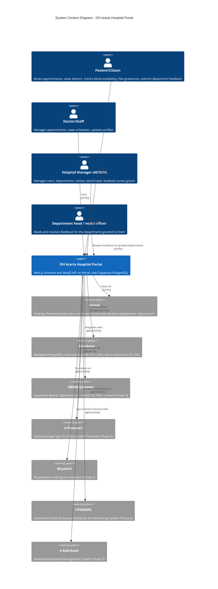
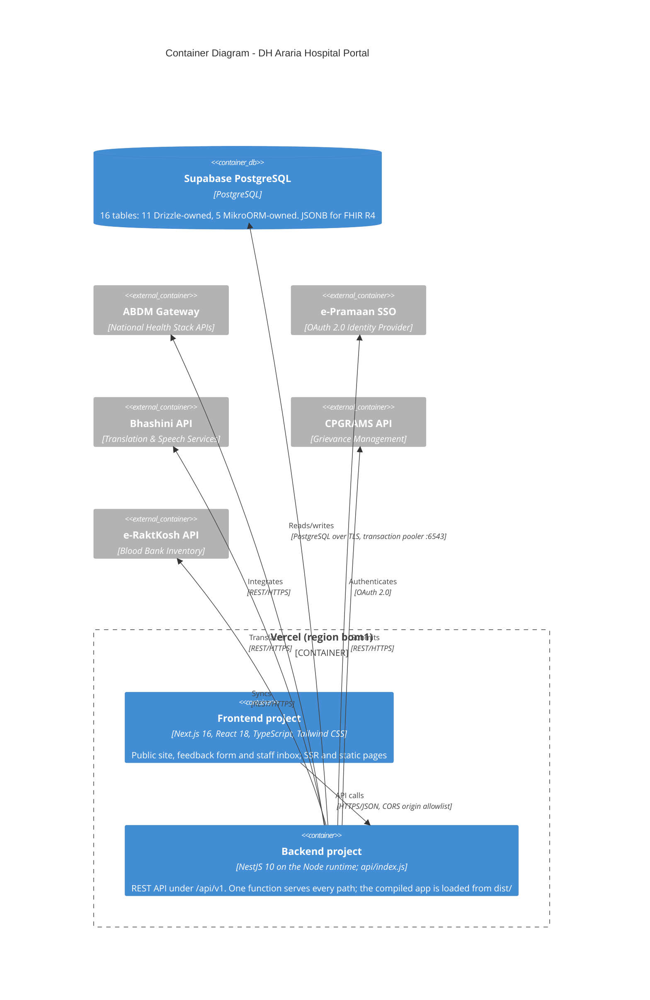
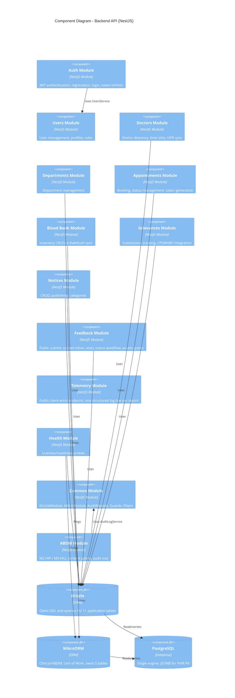

# DH Araria Hospital Portal - Architecture Documentation

## Overview

This document describes the architecture of the District Hospital Araria Digital Healthcare Portal, a modern, accessible, and scalable digital healthcare platform built following Government of India standards.

## System Context



## Container Diagram



Both entry points share `src/bootstrap.ts`: `src/main.ts` adds `listen()` for
local development and any long-lived Node host, and `api/index.js` calls
`createApp({ init: true })` and hands the Express instance to Vercel. Middleware,
the `api` prefix, URI versioning, validation, filters and interceptors therefore
cannot drift between the two deployment shapes. The function must load
`dist/bootstrap` rather than `src/`, because Vercel transpiles TypeScript
functions without `emitDecoratorMetadata`.

## Component Diagram - Backend



## Database and ORM Architecture

### Primary Database: PostgreSQL 15+

We use PostgreSQL as our single database engine for the entire project. For standard relational data (users, roles, basic appointments), we use standard tables. For the deeply nested, unstructured FHIR R4 medical records mandated by the Ayushman Bharat Digital Mission (ABDM), we utilize PostgreSQL's native `JSONB` columns instead of introducing a separate NoSQL database. This keeps the cloud infrastructure simple and reduces long-term maintenance.

#### JSONB for FHIR R4 Bundles

The `FhirBundle` entity uses a `JSONB` column to store complete FHIR R4 bundles:

```ts
// apps/backend/src/modules/abdm/entities/fhir-bundle.entity.ts — MikroORM owns this table
export type FhirBundleStatus = 'PENDING' | 'ENCRYPTED' | 'PUSHED' | 'DELIVERED' | 'FAILED';

@Entity({ tableName: 'fhir_bundles' })
export class FhirBundle {
  @PrimaryKey()
  id: string = newId();

  @Property()
  @Unique()
  bundleId!: string;

  @Property({ default: 'Bundle' })
  resourceType: string = 'Bundle';

  @Property()
  bundleType!: string;

  @Property()
  patientId!: string;

  @Property({ nullable: true })
  careContextId?: string;

  /** The FHIR R4 resource graph itself. */
  @Property({ type: 'jsonb' })
  fhirJson!: Record<string, unknown>;

  @Property({ type: 'text', nullable: true })
  encryptedData?: string;

  @Property({ nullable: true })
  encryptionKey?: string;

  @Property({ default: 'PENDING' })
  status: FhirBundleStatus = 'PENDING';

  @Property({ onCreate: () => new Date() })
  createdAt: Date = new Date();

  @Property({ onUpdate: () => new Date() })
  updatedAt: Date = new Date();
}
```

This approach provides:
- **Schema Flexibility**: FHIR R4 resources have complex, variable structures that map naturally to JSONB
- **Query Performance**: PostgreSQL's GIN indexes on JSONB enable fast querying of FHIR elements
- **ACID Compliance**: Full transactional support for health data operations
- **Simplified Infrastructure**: No separate MongoDB/NoSQL cluster needed

### Data Access Strategy

PostgreSQL is the **single** database engine. Two ORMs talk to it, each with
its own connection pool and a non-overlapping set of tables:

| Client | Owns | Rationale |
|--------|------|-----------|
| **Drizzle ORM** | 11 tables: users, departments, doctors, time_slots, appointments, blood_stock, grievances, notices, contact_messages, feedback, feedback_viewers | SQL-first, near-zero abstraction overhead for the high-traffic public endpoints; owns DDL for its tables |
| **MikroORM** | 5 tables: abha_profiles, care_contexts, fhir_bundles, consent_artefacts, audit_logs | Strict Unit of Work so a FHIR bundle, its consent artefact and its audit rows commit atomically |

The boundary exists because the two halves have different transaction needs.
ABDM and audit writes are relationally rich and must commit as one unit with
their audit row, which is what MikroORM's identity map and Unit of Work provide.
Application tables are read-heavy with explicit joins and projections, where
Drizzle's predictable SQL and small runtime are the better fit. Letting either
tool describe the other's tables would duplicate the schema and invite drift, so
each table has exactly one owner (`docs/adr/0001-dual-orm-table-ownership.md`).

`feedback` and `feedback_viewers` joined the Drizzle side in ADR-0002. Feedback
is read-heavy, joins directly to `departments`, and is written by a public
endpoint with no transaction spanning ABDM entities; `feedback_viewers` is a
join table over `users` and `departments`, both already Drizzle-owned, and
putting it in MikroORM would create a cross-ORM foreign key. The Drizzle count
became 11 and the MikroORM count stayed 5.

#### One schema, two DDL owners: how drift is prevented

Ownership is enforced mechanically rather than by convention
(`docs/adr/0001-dual-orm-table-ownership.md`):

- `src/common/drizzle/schema.ts` → `drizzle-kit generate` writes the SQL in
  `apps/backend/drizzle/`. Those migrations are committed and applied by
  `npm run db:migrate`.
- `src/common/mikro/mikro.config.ts` and the ABDM entities are reconciled by
  `updateSchema({ safe: true })` in the same `db:migrate` script.
- `npm run schema:check` reads both schemas **offline** and fails if a table
  appears in both, if a Drizzle migration touches a Mikro-owned table, or if the
  counts drift from 11 + 5.
- `npm run schema:check:live` additionally compares the entities against a live
  database.

Primary keys are text UUIDs minted in the application with Node's built-in
`crypto.randomUUID()` via `src/common/drizzle/id.ts`, because `drizzle-kit`
emits no database-side default for them.

#### Drizzle ORM (Citizen-Facing Services)

`DrizzleModule` publishes the raw Drizzle instance under the `DRIZZLE` token and
owns the pool lifecycle:

```typescript
// apps/backend/src/common/drizzle/drizzle.module.ts
import { Global, Module } from '@nestjs/common';
import { DrizzleService } from './drizzle.service';

export const DRIZZLE = 'DRIZZLE';

@Global()
@Module({
  providers: [
    DrizzleService,                                    // owns the pg.Pool
    { provide: DRIZZLE, useFactory: (s) => s.db, inject: [DrizzleService] },
  ],
  exports: [DrizzleService, DRIZZLE],
})
export class DrizzleModule {}
```

The pool is built in `DrizzleService`'s **constructor** (not `onModuleInit`) so
the `DRIZZLE` factory always sees a ready handle:

```typescript
// apps/backend/src/common/drizzle/drizzle.service.ts
@Injectable()
export class DrizzleService implements OnModuleDestroy {
  readonly pool: Pool;
  readonly db: DrizzleDb;

  constructor(config: ConfigService) {
    this.pool = new Pool({ /* host/port/creds from validated config */ });
    this.db = drizzle(this.pool, { schema });
  }

  async onModuleDestroy() { await this.pool.end(); }
}
```

Consuming it:

```typescript
// apps/backend/src/modules/notices/notices.service.ts
@Injectable()
export class NoticesService {
  constructor(@Inject(DRIZZLE) private readonly db: DrizzleDb) {}

  async findPublished(pagination: PaginationDto, language?: string) {
    return this.db
      .select()
      .from(notices)
      .where(
        and(
          eq(notices.isPublished, true),
          or(isNull(notices.expiresAt), gte(notices.expiresAt, new Date())),
        ),
      )
      .orderBy(desc(notices.publishedAt))
      .limit(pagination.limit ?? 10);
  }
}
```

**Key Benefits**:
- **Zero Abstraction Overhead**: Near-raw SQL performance
- **Type-Safe SQL**: Full TypeScript inference from the schema
- **Lightweight**: ~10KB bundle size
- **Connection Pooling**: Native `pg` pool integration

#### MikroORM (Clinical & ABDM Services)

**Used for**: ABDM M2 (HIP — FHIR bundle generation), ABDM M3 (HIU — consent
management), clinical records, and the CERT-In audit trail.

```typescript
// apps/backend/src/common/mikro/mikro.module.ts
import { Global, Module, Provider } from '@nestjs/common';
import { MikroORM } from '@mikro-orm/core';
import { createMikroOrmConfig } from './mikro.config';

export const MIKRO_ORM = 'MIKRO_ORM';
export const ENTITY_MANAGER = 'ENTITY_MANAGER';

const mikroOrmProvider: Provider = {
  provide: MIKRO_ORM,
  useFactory: async () => MikroORM.init(createMikroOrmConfig()),
};

@Global()
@Module({
  providers: [
    mikroOrmProvider,
    { provide: ENTITY_MANAGER, useFactory: (orm) => orm.em.fork(), inject: [MIKRO_ORM] },
  ],
  exports: [MIKRO_ORM, ENTITY_MANAGER],
})
export class MikroModule {}
```

Services inject `ENTITY_MANAGER` and wrap writes in `em.transactional(...)` so
the clinical change and its audit rows land together:

```typescript
// apps/backend/src/modules/abdm/abdm.service.ts
@Injectable()
export class AbdmService {
  constructor(
    @Inject(ENTITY_MANAGER) private readonly em: EntityManager,
    private readonly audit: AuditLogService,
  ) {}

  async recordBundle(input: RecordBundleInput): Promise<FhirBundle> {
    return this.em.transactional(async (em) => {
      const bundle = em.create(FhirBundle, { /* … */ } as any);
      await em.persistAndFlush(bundle);

      await this.audit.logWith(em, {
        action: 'FHIR_BUNDLE_CREATE',
        resource: 'FhirBundle',
        resourceId: bundle.id,
        details: { bundleId: bundle.bundleId, entryCount: /* … */ },
      });

      return bundle;
    });
  }
}
```

Audit rows are written through `AuditLogService.logWith(em, …)`, which uses the
*same* EntityManager as the business change — that is what makes the audit trail
impossible to bypass, and it is why the audit write is transactional rather than
a best-effort side effect.

**Key Benefits**:
- **Unit of Work**: Guarantees atomic transactions for complex health data operations
- **Identity Map**: Prevents duplicate entities in memory
- **Change Tracking**: Only modified fields are persisted
- **Transaction Boundaries**: Explicit transaction control for ABDM flows

### ORM Selection Guide for Developers

| Module / Service | Client | Reason |
|------------------|--------|--------|
| Auth, Users | Drizzle | Identity rows live in `users`, owned by `UsersService` |
| Homepage / Landing Page | Drizzle | High traffic, simple queries |
| Doctor Directory, Departments | Drizzle | Read-heavy, public access |
| Appointments | Drizzle | High concurrency, transactional booking |
| Grievance Submission | Drizzle | Public-facing, moderate traffic |
| Blood Bank Inventory | Drizzle | Real-time polling, simple reads |
| Notices / Announcements | Drizzle | Read-heavy, public |
| Contact messages | Drizzle | Public write, admin inbox |
| Department feedback | Drizzle | Public write, per-department reads and aggregates, joins `departments` |
| **ABDM M2 (HIP)** | **MikroORM** | **FHIR bundles, Fidelius encryption, atomic transactions** |
| **ABDM M3 (HIU)** | **MikroORM** | **Consent management, audit trails** |
| **Clinical Records** | **MikroORM** | **Complex transactions, audit logging** |
| **Audit Logging** | **MikroORM** | **Append-only trail inside the same Unit of Work** |

### Shared Database Connection & Pool Budget

Both clients open their own pool against the same PostgreSQL instance. That is
fine on a long-lived server and dangerous on Vercel: every warm function
instance owns a pool, so the number of instances multiplies the pool size.
Supabase's transaction pooler multiplexes those connections, but it still has a
per-project limit.

Set both sizes explicitly in the backend Vercel project:

| Client | Env var | Vercel | Local (unset) |
|--------|---------|--------|---------------|
| Drizzle | `DRIZZLE_POOL_SIZE` | `1` | 20 |
| MikroORM | `MIKRO_POOL_SIZE` | `1` | 20 |
| MikroORM idle floor | `MIKRO_POOL_MIN` | `0` | 0 |

Do not rely on the serverless detection in `src/config/configuration.ts`. The
Joi schema in `src/config/validation.ts` gives `DRIZZLE_POOL_SIZE` and
`MIKRO_POOL_SIZE` a default of 20, and `@nestjs/config` copies those defaults
into `process.env` before the configuration factory runs. An unset variable
therefore resolves to 20 even when `VERCEL` is set. `MIKRO_POOL_MIN=0` is
already the code default and stops a cold instance from opening connections
eagerly.

Locally, `docker-compose.yml` raises `max_connections` to 200, so the default
sizes are safe there. `GET /api/v1/health` reports Drizzle and MikroORM
reachability plus live Drizzle pool stats. MikroORM's pool counters are not
exported, so a saturated MikroORM pool shows up as a failed probe or a
connection timeout rather than a metric.

---

## Data Model (ER Diagram)

```mermaid
erDiagram
    USER ||--o{ APPOINTMENT : "patient"
    USER ||--o{ APPOINTMENT : "doctor"
    USER ||--o{ GRIEVANCE : "files"
    USER ||--o{ NOTICE : "authors"
    DOCTOR ||--o{ APPOINTMENT : "has"
    DOCTOR }|--|| USER : "extends"
    DOCTOR }|--|| DEPARTMENT : "belongs to"
    DEPARTMENT ||--o{ DOCTOR : "has"
    DEPARTMENT ||--o{ APPOINTMENT : "has"
    DOCTOR ||--o{ TIME_SLOT : "has"
    BLOOD_STOCK }|--|| BLOOD_GROUP : "typed"
    BLOOD_STOCK }|--|| COMPONENT_TYPE : "typed"
    GRIEVANCE }|--|| USER : "assigned to"
    NOTICE }|--|| USER : "authored"
    DEPARTMENT ||--o{ FEEDBACK : "receives"
    USER ||--o{ FEEDBACK_VIEWERS : "holds grant"
    USER ||--o{ FEEDBACK_VIEWERS : "grants"
    DEPARTMENT ||--o{ FEEDBACK_VIEWERS : "scopes"
    
    USER {
        string id PK
        string email UK
        string password
        string name
        string phone UK
        enum role
        boolean isActive
        string abhaId UK
        datetime createdAt
        datetime updatedAt
    }
    
    DOCTOR {
        string id PK
        string userId FK UK
        string name
        string specialization
        string qualification
        int experience
        string hprId UK
        string departmentId FK
        float consultationFee
        string[] languages
        string bio
        string imageUrl
        boolean isActive
    }
    
    DEPARTMENT {
        string id PK
        string name UK
        string description
        string icon
        string imageUrl
        boolean isActive
    }
    
    APPOINTMENT {
        string id PK
        string patientId FK
        string doctorId FK
        string departmentId FK
        datetime appointmentDate
        string startTime
        string endTime
        enum status
        enum type
        string reason
        string notes
        string abhaId
        int tokenNumber
    }
    
    BLOOD_STOCK {
        string id PK
        enum bloodGroup
        enum componentType
        int unitsAvailable
        datetime lastUpdated
    }
    
    GRIEVANCE {
        string id PK
        string userId FK
        string name
        string email
        string phone
        enum category
        string subject
        string description
        enum status
        string cpgramsId UK
        string assignedTo FK
        string resolution
    }
    
    NOTICE {
        string id PK
        string title
        string content
        enum category
        enum priority
        datetime publishedAt
        datetime expiresAt
        boolean isPublished
        string attachmentUrl
        string language
        string authorId FK
    }

    FEEDBACK {
        string id PK
        string departmentId FK
        enum serviceArea
        int rating
        int cleanliness
        int staffBehaviour
        int waitTime
        string comment
        string name
        string phone
        string email
        enum status
        datetime createdAt
        datetime updatedAt
    }

    FEEDBACK_VIEWERS {
        string id PK
        string userId FK
        string departmentId FK
        string grantedBy FK
        datetime createdAt
    }
```

The ER diagram is illustrative rather than exhaustive: `contact_messages` and
`time_slots` are also Drizzle-owned but omitted here because nothing in the
feedback or ABDM flows joins through them.

## Feedback Architecture

Department feedback is a separate flow from grievances. It is anonymous by
default, tied to one department and one service area, and readable only by the
Hospital Manager (the `ADMIN` role) and by staff explicitly granted that
department.

### Submission flow

1. The citizen opens `/feedback`, which lists active departments, or follows a
   direct link to `/feedback/<departmentId>`.
2. The form posts to `POST /api/v1/feedback`. The route is `@Public()` and
   throttled to 5 requests per minute per IP.
3. `CreateFeedbackDto` rejects a non-empty `website` field. That field is the
   honeypot: it is hidden in the form, so any value means a bot filled it.
4. `FeedbackService.create()` verifies the department exists and is active,
   then writes the row field by field. Ids, `status` and timestamps are
   server-owned and cannot be set by the caller.
5. The row starts in `NEW`. There is no email or SMS notification; the inbox is
   pull-based.

### Two-layer visibility

| Layer | Where | What it decides |
|-------|-------|-----------------|
| Route guard | `JwtAuthGuard` + `RolesGuard` on the controller | The caller is signed in. `access` routes additionally require `ADMIN`. |
| Department scope | `FeedbackService.accessibleDepartmentIds()` and `requireDepartmentAccess()` | Which feedback rows the caller may read or update. |

`ADMIN` resolves to "all departments" and bypasses `feedback_viewers`. Every
other authenticated role sees only the departments granted to it. An empty grant
list is a valid state that returns an empty page, not an error.

Scope is enforced in the service rather than the controller so a future route
cannot widen it by omitting a decorator. The same helpers feed the list, the
stats and the status update, which keeps the three consistent.

`requireDepartmentAccess()` returns 404 for a missing row and 403 for a row in a
department the caller cannot read. That leaks existence to an authenticated
user who guesses an id; it does not expose content, and it is deliberate enough
to keep, but it is a distinguishable response.

### Reads, stats and workflow

- `GET /api/v1/feedback/scope` returns `{ all, departments }`, filtered to
  active departments for the picker. A grant for a department that was later
  deactivated still permits reading its historical feedback.
- `GET /api/v1/feedback` is paginated, filterable by department, status, service
  area and date, with an allow-listed sort column.
- `GET /api/v1/feedback/stats` returns totals, averages for the overall and
  criterion ratings, a status breakdown, a 1–5 rating histogram and a
  per-department roll-up. All aggregates respect the same scope.
- `PATCH /api/v1/feedback/:id/status` moves a row between `NEW`,
  `ACKNOWLEDGED` and `RESOLVED`. Any transition is allowed; the workflow is not
  enforced as a state machine.

### Access grants

`POST /api/v1/feedback/access` and `DELETE /api/v1/feedback/access/:id` are
`ADMIN`-only, and `FeedbackService` re-checks the role. Each stored row is one
`(userId, departmentId)` pair, unique; the request accepts one or more
department ids and creates the pairs in a single call. Only staff accounts can
receive grants: a `PATIENT` account is rejected with 400, because feedback rows
can contain the contact details of other patients.

### Why Drizzle owns these tables

Feedback is read-heavy, joins directly to `departments`, and is written by a
public endpoint with no transaction spanning ABDM entities. `feedback_viewers`
is a join table over `users` and `departments`, both already Drizzle-owned;
placing it in MikroORM would create a cross-ORM foreign key. ADR-0002 records
the decision.

## Deployment Architecture

```mermaid
C4Deployment
    title Deployment Diagram - Vercel + Supabase

    Node(operator, "Operator workstation or CI", "Developer machine, GitHub Actions") {
        Container(cli, "npm scripts", "db:migrate, db:seed, bootstrap:admin", "Run against the direct connection")
    }

    Node(vercel, "Vercel (region bom1)") {
        Container(frontend, "Frontend project", "Next.js 16", "SSR, static assets, /feedback and /feedback/inbox")
        Container(backend, "Backend project", "Node function api/index.js", "NestJS app loaded from dist/, serves /api/v1/*")
    }

    Node(supabase, "Supabase project", "Region chosen at project creation - verify in the console") {
        ContainerDb(pooler, "Transaction pooler :6543", "PgBouncer", "Application traffic from both ORMs")
        ContainerDb(direct, "Direct connection :5432", "PostgreSQL", "DDL, migrations, seed, bootstrap:admin")
        ContainerDb(db, "Database", "PostgreSQL 15+", "11 Drizzle tables and 5 MikroORM tables")
    }

    Node(ext, "External systems (Phase 3)") {
        Component(abdm, "ABDM Gateway")
        Component(epramaan, "e-Pramaan SSO")
        Component(bhashini, "Bhashini API")
        Component(cpgrams, "CPGRAMS")
        Component(eraktkosh, "e-RaktKosh")
    }

    Rel(operator, direct, "Applies migrations and seeds", "PostgreSQL/TLS")
    Rel(frontend, backend, "Calls /api/v1", "HTTPS/JSON")
    Rel(backend, pooler, "Reads/writes", "PostgreSQL/TLS")
    Rel(pooler, db, "Multiplexes")
    Rel(direct, db, "Connects")
    Rel(backend, ext, "Integrates", "REST/HTTPS")
```

The backend project is a single Vercel Function: `api/index.js` rewrites every
path to the Nest application, which applies its own `/api` prefix and URI
versioning. `vercel.json` pins `bom1`, 1024 MB and a 30-second `maxDuration`.
The `functions` key still names `api/index.ts` while the committed entry point
is `api/index.js`; until those agree, treat the memory and duration values as
advisory and confirm the effective limits in the Vercel dashboard.

## Security Architecture

### Defense in Depth

1. **Edge and Network**
   - Vercel terminates TLS for both projects and provides platform DDoS
     mitigation (confirm the plan's guarantees in the Vercel dashboard).
   - The database is reached only through Supabase's pooler or direct endpoint
     over TLS. `resolveDatabaseConnection()` enables TLS for every non-local
     host, and `?sslmode=require` in `DATABASE_URL` forces it explicitly.
   - Supabase network restrictions (IP allowlisting) are a plan-dependent
     feature; verify whether they are enabled in the console.

2. **Transport**
   - HTTPS between browser, Vercel and Supabase; no plaintext listener exists in
     the deployment.
   - `helmet()` applies its default header set, including HSTS. CSP is enabled in
     production and disabled in development.
   - Certificate pinning is not implemented; outbound calls rely on the platform
     trust store.

3. **Application**
   - `ValidationPipe` with `whitelist` and `forbidNonWhitelisted`; validation
     messages are suppressed when `NODE_ENV=production`.
   - CORS allowlist from `FRONTEND_URL`, which may be a comma-separated list so
     the production domain and a Vercel preview can coexist.
   - Rate limiting: 100 req/min global, 10 req/min on auth, 5 req/min on the
     public feedback write.
   - `trust proxy` is set to 1 on Vercel, so the throttler keys on the visitor IP
     instead of bucketing every visitor behind the edge.
   - Queries are parameterised through Drizzle and MikroORM; React escapes
     rendered text.
   - 5xx responses are replaced with a generic `INTERNAL_ERROR` body in
     production; the original message and stack stay in the function logs.

4. **Data**
   - Encryption at rest is Supabase-managed; verify the project's settings.
   - No application-level field encryption is active yet. `fhir_bundles` carries
     `encryptedData` and `encryptionKey` for the Phase 3 Fidelius flow.
   - `audit_logs` is written in the same MikroORM transaction as the clinical
     change, so a successful write cannot exist without its audit row.

5. **Identity and Access**
   - JWTs are signed with **HS256** using `JWT_SECRET`. The example value is
     rejected in production and the secret must be at least 32 characters.
   - Access tokens expire in 15 minutes, refresh tokens in 7 days.
   - There is no refresh-token rotation and no denylist: logout is client-side,
     and a stolen refresh token remains valid until it expires. Treat this as a
     known gap rather than a control.
   - RBAC is enforced by `RolesGuard`. Feedback reads are additionally scoped
     per department inside `FeedbackService`, so a new route cannot widen scope
     by forgetting a guard.
   - e-Pramaan SSO is Phase 3 and not wired.

### CERT-In Compliance

- 180 days is the configured log-retention target
  (`certIn.logRetentionDays`), but nothing in the repository enforces it: no
  scheduled job prunes or exports logs. Vercel's own function-log retention is
  far shorter, so forwarding logs to a retention store is an operator task.
- 6-hour incident reporting is a process commitment, not an application
  feature.
- NTP synchronisation is provided by the hosting platform. The
  `time.nic.in` / `time.nplindia.org` values in configuration are documentation,
  not an active NTP client.
- Monthly vulnerability scans and secure configuration baselines are operational
  controls; `npm run audit:ci` covers dependency advisories only.

## Accessibility Architecture

### WCAG 2.2 AA / GIGW 3.0 Compliance

1. **Perceivable**
   - Semantic HTML5 structure
   - Text alternatives for all non-text content
   - 4.5:1 contrast ratio (3:1 for large text)
   - Responsive text up to 200% zoom
   - No content loss at 320px width

2. **Operable**
   - Full keyboard navigation
   - Focus indicators (2px solid, 3:1 contrast)
   - No keyboard traps
   - Skip to main content link
   - No seizure-inducing content

3. **Understandable**
   - Consistent navigation
   - Clear form labels and instructions
   - Error identification and suggestions
   - Language declaration (lang attribute)

4. **Robust**
   - Valid HTML5
   - ARIA roles/attributes where needed
   - Compatible with NVDA, JAWS
   - Graceful degradation

### Implementation Stack
- **Tailwind CSS** - Utility-first styling with contrast and focus utilities
- **React Testing Library + Jest** - Component tests, including label and keyboard assertions
- **Manual testing** - keyboard-only and screen-reader checks (NVDA/JAWS); no axe automation is wired up yet

## Integration Architecture

### Phase 1: MVP (Current)
- Next.js frontend and NestJS API as two Vercel projects in `bom1`
- Supabase PostgreSQL with the 11 + 5 table split
- Internal JWT authentication (HS256)
- No file-upload endpoint and no object storage; `UPLOAD_PATH` is configured but
  unused, and Vercel's function filesystem is ephemeral
- External DPI integrations are not enabled: the clients and configuration keys
  exist, but no production credentials are set

### Phase 2: Compliance Hardening
- Forward function logs to a retention store and enforce the 180-day target
- Content Management Policy (CMAP)
- Content Archival Policy (CAP)
- Security audit preparation and dependency-advisory gating (`npm run audit:ci`)
- Object storage for uploads

### Phase 3: DPI Integrations

| Integration | Protocol | Purpose | Status |
|-------------|----------|---------|--------|
| **Bhashini** | REST/HTTPS | 22-language translation, ASR/TTS | Planned |
| **e-Pramaan** | OAuth 2.0 | Citizen SSO via Meri Pehchaan | Planned |
| **CPGRAMS** | REST/HTTPS | Grievance forwarding & tracking | Planned |
| **e-RaktKosh** | REST/HTTPS | Real-time blood inventory sync | Planned |
| **ABDM M1** | REST/HTTPS | ABHA creation, verification | Planned |
| **ABDM M2** | FHIR R4 + Fidelius | HIP - Generate encrypted health records | Planned |
| **ABDM M3** | FHIR R4 + Fidelius | HIU - Request/consume health records | Planned |

### ABDM Technical Details

```
ABDM Integration Flow (M2 - HIP):
1. PHR App requests records via ABDM Gateway
2. Gateway sends webhook to /api/abdm/on-discover
3. Backend acknowledges with HTTP 202
4. Backend discovers matching care contexts
5. Backend encrypts FHIR Bundle via Fidelius (ECDH + AES-GCM)
6. Backend pushes to ABDM Gateway callback URL
7. Gateway delivers to requesting PHR App

FHIR Bundle Requirements:
- Profile: ABDM FHIR R4
- Terminology: SNOMED CT, LOINC, ICD-10
- Encryption: Fidelius (ECDH P-256 + AES-256-GCM)
- Consent: Time-bound with auto-expiry
```

## Performance Requirements

| Metric | Target | Measurement |
|--------|--------|-------------|
| **Page Load (FCP)** | < 1.5s | Lighthouse/Real User Monitoring |
| **Page Load (LCP)** | < 2.5s | Lighthouse/Real User Monitoring |
| **API Response (p95)** | < 500ms | APM/Load Testing |
| **API Response (p99)** | < 1s | APM/Load Testing |
| **Availability** | 99.9% | Uptime Monitoring |
| **Concurrent Users** | 10,000+ | Load Testing |
| **Database Connections** | 1 per ORM per warm function instance | `DRIZZLE_POOL_SIZE` / `MIKRO_POOL_SIZE`; Drizzle counters on `/health` |

The connection target is a ceiling, not a promise: the effective concurrency is
the number of warm Vercel instances multiplied by these two pools, multiplexed by
Supabase's transaction pooler.

## Monitoring and Observability

### Health endpoint

`GET /api/v1/health` and `GET /api/v1/health/ready` probe both ORMs in parallel
and return a Terminus-shaped body that includes live Drizzle pool counters. They
return 503 with the same body when either connection fails. `/health/live`
performs no I/O and only confirms the function is running.

### Logs

- Nest's `Logger` writes to stdout; Vercel captures the lines per invocation.
- `LoggingInterceptor` logs method, URL, user, IP and user agent on entry, then
  status and duration on completion or failure.
- `HttpExceptionFilter` logs every 5xx with the original error and stack while
  returning the redacted body to the client.
- `POST /api/v1/client-errors` turns a browser error report into one structured
  `client_error` log line. It does not persist anything; the path is stripped of
  query parameters because they can carry PII.
- There is no distributed tracing and no trace-ID propagation.

### Metrics and alerting

The repository ships no metrics backend, dashboards or alert routes, and no
Redis or queue consumers. Vercel's function metrics (invocations, errors,
duration) and Supabase's database metrics (connections, slow queries) are the
available sources. Alerting and uptime checks are configured in those consoles,
not in this codebase.

## Disaster Recovery

Recovery is delegated to the two managed platforms; the repository contains no
replication, WAL-archiving or failover automation.

### Targets

| Item | Target | Provided by |
|------|--------|-------------|
| **RPO** | Plan-dependent: daily backups, plus point-in-time recovery on paid Supabase plans | Supabase |
| **RTO** | Time to restore a backup or roll back a deployment; verify against the chosen plan and rehearse | Supabase + Vercel |

Confirm the actual backup schedule, PITR window and retention for the Supabase
plan in the console before quoting an RPO to the hospital.

### Backup and restore

- Supabase takes automated backups; PITR is a paid-plan feature. Take a manual
  logical backup before any destructive migration (`pg_dump` against the direct
  connection).
- Restore drills are operator runbooks, not scripts in this repository.
- Vercel keeps previous deployments, so a bad release is rolled back by
  promoting the last healthy deployment. A rollback does **not** revert a
  migration; schema changes must be backward compatible for one release.

### Failure modes

| Failure | Effect | Response |
|---------|--------|----------|
| Backend function unhealthy | `/api/v1/*` returns 5xx; frontend still serves | Check `/health`, then Vercel function logs and Supabase connection limits |
| Supabase unavailable | Both ORMs fail, health returns 503 | Wait for the platform, or restore to a new project and repoint `DATABASE_URL` |
| Bad deployment | Errors start at release time | Promote the previous Vercel deployment |
| Bad migration | Writes fail after `db:migrate` | Restore from backup or PITR; do not re-run `db:migrate` blindly |

## Development Standards

### Code Quality Gates
- TypeScript strict mode
- ESLint (no errors, warnings allowed)
- Prettier formatting
- 80% unit test coverage
- 100% critical path coverage
- axe-core accessibility tests in CI

### Git Workflow
- Trunk-based development
- Feature flags for incomplete work
- Conventional commits
- PR reviews required
- Automated CI checks

### Release Process
- Semantic versioning
- Automated changelog
- Staging deployment
- Production deployment with rollback
- Post-deployment smoke tests

---

*Document Version: 2.0*  
*Last Updated: 2026-10-24*  
*Classification: Internal - Government Use*
